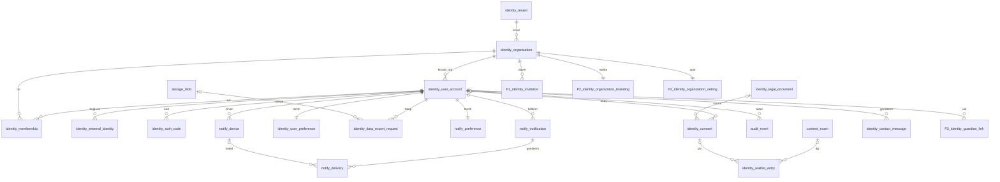
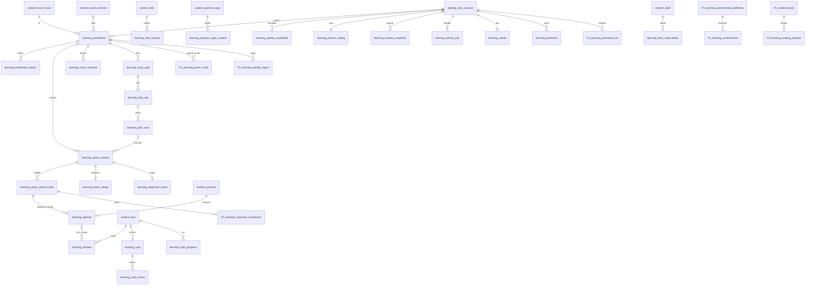

# sinav · P0 mimari ve veri planı

Durum: **onay bekliyor** · 2026-10-08 · Onaydan sonra bu dosya `sinav-mono-repo/docs/PLAN-P0.md` olarak repoya girer; kararlar `docs/DECISIONS.md`'ye işlenir.

## 0. Bağlam ve ana kararlar

Birden çok sınava (önce YDS) hazırlık platformu. Kaynaklar: şablon (`MONOREPO-ARCHITECTURE-TEMPLATE.md` 2.0), tasarım dokümanı (151 ekran, 92 P0), 582 HTML çizim (P0'ın tamamında web+mobil, açık+koyu; CMS yalnızca web), `ds-light/dark.json`, pazar analizi. Ürün yıllarca büyüyeceği için asıl yatırım **veri modelinde**: sınav, bölüm, soru tipi, beceri, puanlama ve takvim veri olarak tutulur; P1–P3 yalnızca ekleme yapan migration'larla gelir.

Ana kararlar:
1. **Çok servis**: gateway + 5 domain servisi (identity, content, learning, billing, tutor). Gerekçe §1.1.
2. **Kişisel organizasyon**: her kullanıcı (misafir dahil) kendi `individual` organizasyonuna sahip; öğrenci verisi şablonun kapsam kolonuyla (`_organization_id`) kendiliğinden yalıtılır. Platform içeriği `platform` organizasyonuna aittir. Kurum (P2) aynı modelin üstüne yeni tip + üyelik olarak gelir.
3. **Misafir hesap**: §11.1'de kayıt seviye tespitinden sonra istenir. "Başla" anında misafir hesap + oturum açılır; kayıt = misafir hesabın yükseltilmesi (veri taşıma/birleştirme yok).
4. **İçerik = kimlik + değişmez revizyon**: `content.item` kararlı kimlik, her tür için gövde tabloları revizyona 1:1. Öğrenci yalnızca yayımlanmış revizyonu görür; denemeler ve cevaplar revizyona bağlanır, sonraki düzenleme geçmişi bozmaz.
5. **Mobil oturum**: gateway'e "bearer taşıma" eklenir (çerez + CSRF web'de aynen kalır). §5.
6. **Paylaşım**: monorepo tek kaynak; token, API istemcisi ve i18n paketleri `sinav-mobile`'a sürüm damgalı kopyalanır, sapma bir komutla yakalanır. §6.
7. **Dış hesap gerektirenler** (ödeme sağlayıcısı, Apple/Google girişi, sunucu push'u, e-Arşiv) port arkasında; geliştirmede sahte/yerel adaptörle uçtan uca çalışır, gerçek adaptör `BEKLİYOR`. **Yapay zekâ OpenRouter üzerinden** (senin anahtarınla); sağlayıcı ve model adları env'de, başka sağlayıcıya geçiş tek adaptör.
8. **Tanıtım sitesi de bu oturumda**: şablon §17'deki ayrı origin'li Astro uygulaması (`sinav-landing-app`), P0 MKT sayfalarının hepsi. Blog, rehber ve yardım makaleleri veritabanında, editoryal akışı sınav içeriğiyle aynı (taslak → inceleme → yayın); site onları derleme anında public API'den çeker.

Pazar analizindeki Next.js/TypeScript/pnpm önerisi yerine şablon ve senin kuralın geçerli: React 19 + Vite, Expo, yalnızca JS, npm workspaces.

---

## 1. Servis ayrımı ve klasör ağaçları

### 1.1 Karar: çok servis (§20'nin tek servis varyantı seçilmedi)

- Bağlamlar farklı hızda değişir ve farklı şekilde bozulur: yapay zekâ sağlayıcısının çökmesi deneme çözmeyi durdurmamalı (tutor ayrı); ödeme webhook'ları ve kart verisi ayrı güvenlik sınırında olmalı (billing ayrı); içerik okuma ağırlıklı ve önbellekli, öğrenme yazma ağırlıklı.
- Şema sahipliği "çekirdek sınavı tanımaz" ilkesini zorlar: sınav kuralları yalnızca `content` şemasında yaşar; learning onları veri olarak okur.
- Maliyeti düşük: servis kabuğu ve `core/` şablondan kopyalanır, aynı veritabanı kullanılır. Şablon §4.1 şemalar arası **okumaya** izin verir; çapraz **yazım** sahibi servise HTTP ile ya da `app-shared` içindeki tek uygulamayla yapılır. Bu sayede learning, content tablolarını SQL ile okuyup soru seçebilir; her soru için HTTP atlaması yoktur.
- Reddedilen: tek servis (sınırlar kodda kaybolur, 5 yıl sonra bölmek pahalı) ve daha ince bölme (notify, social, classroom şimdiden servis olsaydı P0'da boş servisler olurdu; P1/P2'de eklenir, portları şimdiden ayrılır).

### 1.2 Servis tablosu (`PORT_BASE = 2000`, gerekçe §8)

| Servis | Port | Sahip olduğu şemalar | Dış port (adaptör) |
|---|---|---|---|
| `sinav-web-gateway` | 2000 | – | – |
| `sinav-service-identity` | 2001 | `identity` (bekleme listesi ve iletişim mesajları dahil), `enums`, `notify`, `audit` (yazımı `app-shared` audit modülüyle herkese açık), `storage` (yazımı `app-shared` storage portuyla) | e-posta (SMTP; dev'de Mailpit), push (BEKLİYOR), Apple/Google (BEKLİYOR) |
| `sinav-service-content` | 2002 | `content` (sınav içeriği + blog/rehber/yardım makaleleri) | – (yapay zekâ taslakları tutor üzerinden) |
| `sinav-service-learning` | 2003 | `learning` | – |
| `sinav-service-billing` | 2004 | `billing` | ödeme (`fake` dev, `iyzico` BEKLİYOR), e-Arşiv (BEKLİYOR) |
| `sinav-service-tutor` | 2005 | `tutor` | LLM: `LLM_PROVIDER=openrouter` (OpenAI uyumlu API, akış, kullanım/maliyet bilgisi); anahtar yoksa `not_configured` — tek yapay zekâ ağ geçidi |
| `sinav-service-social` (P1) | 2006 | `social` | – |
| `sinav-service-classroom` (P2) | 2007 | `classroom` | – |

`app` servisi kurulmaz (§19 Faz 7: referans verisi yok); `enums` sahibi identity. `reference` şeması P0'da yok.

### 1.3 Şemalar arası kurallar (ZORUNLU, DECISIONS'a girer)

- Okuma: her servis başka şemayı **salt okunur** SQL ile okuyabilir; öğrenci verisinde her zaman `caller` kapsamıyla süzer. Paylaşılan okuma kodu `packages/modules/shared/persistence/` altında tek yerde durur (ör. `content-read.js`: yayımlanmış soru DTO'su + önbellek; `entitlement-read.js`).
- Yazma: yalnızca sahip servis. İstisnalar şablonun (a) yolu: `audit.event` ve `storage.blob` için `app-shared` modülleri.
- Şemalar arası FK yalnızca **kararlı hedeflere**: `identity.(tenant, organization, user_account, legal_document)`, `enums.*`, `content.*` (içerik hiç silinmez, emekliye ayrılır), `storage.blob`. `learning`, `billing`, `tutor` gibi işlem şemalarına başka şemadan FK verilmez; gerekiyorsa `_code` yumuşak referansı tutulur.

### 1.4 `sinav-mono-repo/`

```
sinav-mono-repo/
├── core/service-{identity,content,learning,billing,tutor}/   # şablon §7.2 birebir; yalnız table-definitions.js farklı
├── services/
│   ├── sinav-web-gateway/                 # §9 + bearer taşıma, bakım modu, SSE geçişi
│   ├── sinav-service-identity/            # auth, hesap, onaylar, tercihler, bildirim kuyruğu, e-posta şablonları
│   ├── sinav-service-content/             # sınav paketi kataloğu, içerik okuma, CMS akışı, istatistik cron'u
│   ├── sinav-service-learning/            # kayıt/hedef, seviye tespiti, plan, oturumlar, ustalık, hata defteri, kelime (FSRS), deneme
│   ├── sinav-service-billing/             # ürün/fiyat/limit, hak (entitlement), ödeme, abonelik cron'ları
│   └── sinav-service-tutor/               # sohbet (SSE), çeviri değerlendirme, LLM portu, kullanım defteri
├── packages/
│   ├── modules/{config,datasource,entity-factory,errors,example-builder,helper,language,middlewares,service-discovery,shared}
│   │   └── shared/domain/                 # SAF modüller (node bağımlılığı yok): scoring, entitlements, study-day, plan-rules…
│   ├── persistence-utils/  query-builder/
│   ├── design-tokens/   (@sinav/design-tokens)   build.mjs → dist/web/{tokens.css,_tokens.scss,mui-theme.js} dist/native/tokens.js
│   ├── client-sdk/      (@sinav/client-sdk)      servis başına uç fonksiyonları, queryKeys, hata kodları, derin bağlantılar, izin sabitleri
│   └── i18n/            (@sinav/i18n)            paylaşılan metinler: keys/<alan>Keys.js ({ anahtar: { tr, en } })
├── db-schemas/
│   ├── 00-enums-schema.sql  01-identity-schema.sql  02-storage-schema.sql  03-notify-schema.sql  04-audit-schema.sql
│   ├── 05-content-schema.sql  06-learning-schema.sql  07-billing-schema.sql  08-tutor-schema.sql
│   ├── 10-seed-data.sql  (tenant, platform org, ürün kataloğu, ücretsiz limitler)
│   ├── A00-bootstrap-database.sql  A98-superadmin-howto.sql  A99-grants.sql
│   ├── seed/yds/*.json                    # gerçekçi YDS içerik paketi (npm run seed okur)
│   └── migrations/                        # 2026-10-xx-N-*.sql (P0 başlangıcı dahil, §2.13)
├── scripts/  build-schema.js apply-migrations.mjs build-role-permission-seed.js validate-auth-config.js
│             sync-role-permissions.mjs env-to-json.mjs ecosystem.config.cjs start-backend.sh update.sh
│             gen-table-definitions.mjs db-fresh.mjs verify-schema-paths.mjs seed/ sync-mobile.mjs
│             check-client-sdk.mjs maintenance.mjs
├── test/  e2e/                            # §15 klasör yapısı, yalnızca .gitkeep (kural gereği test yok)
├── sinav-web-app/                         # §16
├── sinav-landing-app/                     # §17 Astro (statik), ayrı origin: tanıtım sitesi, blog, yardım merkezi
├── design/                                # taşındı: html/ html_orig/ shots/ (git dışı) ds-*.json DESIGN-*.md components.json manifest.json + araç script'leri
├── docs/  ARCHITECTURE.md DECISIONS.md PLAN-P0.md MONOREPO-ARCHITECTURE-TEMPLATE.md tasarim-dokumani.md pazar-analizi-ve-strateji.html palet.png
├── secrets/ (gitignore)   .env.stitch (gitignore)
├── .claude/ .wolf/ .cursor/ .mcp.json CLAUDE.md AGENTS.md
└── docker-compose.dev.yml  ecosystem.config.cjs  eslint.config.js  package.json  package-lock.json  .env.example  .gitignore  README.md
```

`.gitignore` ekleri: `.env.stitch*`, `design/run.log`, `design/nohup.out`, `design/state.json`, `design/state.lock`, `design/qa/`, `design/shots/` (331 MB; `design/render.cjs` ile `html/`'den yeniden üretilir, diskte kalır). `html/` ve `html_orig/` izlenir. E2E dosyaları (`Dockerfile.e2e`, `docker-compose.e2e.yml`, `.env.test.example`) yazılmaz.

### 1.4a `sinav-landing-app/` (şablon §17)

```
sinav-landing-app/
├── astro.config.mjs  package.json (yalnız script'ler; bağımlılıklar kökte, §3.1)  .env.example
├── src/
│   ├── pages/      index · fiyatlar · yds · araclar/{index,puan-hesaplama,kac-dogru-lazim,sinav-takvimi} · seviye-tespiti
│   │               kurucu-uyelik · blog/{index,[kategori],[slug]} · yardim/{index,[kategori],[slug],bize-yaz} · yasal/[belge] · 404 · 500
│   ├── components/ Astro bileşenleri + küçük JS adacıkları: TutorDemo, ScoreCalculator, ExamCountdown, FounderCounter,
│   │               WaitlistForm, ContactForm, HelpSearch, CookieBanner, PriceCards
│   ├── data/*.cache.json   # derleme anı çekiminin son başarılı kopyası; commit'lenir (API kapalıyken derleme bununla çıkar)
│   ├── lib/public-api.mjs  # derleme anında public GET'ler
│   └── styles/             # @sinav/design-tokens CSS değişkenleri + Tailwind 4 teması
└── public/  (favicon, OG görselleri)
```

Yığın şablondaki gibi: Astro 6 `output: 'static'`, Tailwind 4 (`@tailwindcss/vite`, renkler token değişkenlerinden), `@astrojs/sitemap`, `astro-icon` (Lucide seti). Yasal metinler veritabanında olduğundan şablondaki `@<proje>/legal-content` paketi kurulmaz.

### 1.5 `sinav-web-app/src` (şablon §16.2)

```
api/{gateway,identity,content,learning,billing,tutor}.jsx + index.jsx   # @sinav/client-sdk'yi axios'a bağlayan ince modüller
components/   Mui* sarmalayıcılar + öğrenme bileşenleri (OptionRow, QuestionCard, HintLadder, ScoreBand, Countdown,
              StreakBadge, PlanTask, MasteryBar, Flashcard, NoteCard, ExamNavigator, PriceCard, charts/* SVG)
container/    Container.jsx, AuthBootstrap.jsx
features/     auth onboarding diagnostic today study practice vocab mistakes notes translation tutor exam me billing cms system
layouts/      AppShell (kenar çubuğu / alt sekme), FocusLayout (odak modu), AuthLayout, CmsLayout
pages/ router/ shared/{auth,axios,constant,providers,translation,utils} store/ styles/
```

### 1.6 `sinav-mobile/`

```
sinav-mobile/
├── app.config.js  package.json  package-lock.json  babel.config.js  metro.config.js  jsconfig.json  eslint.config.js  .env.example
├── app/                                   # expo-router; yollar web ile aynı Türkçe slug'lar (/bugun, /calis/tip/[tip] …)
│   ├── _layout.jsx                        # sağlayıcı ağacı
│   ├── (auth)/ (onboarding)/ (focus)/     # karşılama-giriş / ONB / odak modu ekranları (soru, deneme, kelime, seviye tespiti)
│   └── (tabs)/{bugun,calis,deneme,ogretmen,ben}/
├── src/
│   ├── api/  components/  features/<domain>/  hooks/  layouts/
│   ├── shared/{auth (secure-store, bearer), http (axios), constant, providers, theme, translation, notifications}
│   ├── shared/vendor/{design-tokens,client-sdk,i18n,domain}/  + manifest.json   # sync-mobile.mjs yazar, elle düzenlenmez
│   └── store/ (zustand: auth, theme, ui, onboarding)
├── assets/fonts (Figtree, Literata, Bricolage Grotesque; OFL)  assets/images
└── docs/DECISIONS.md  README.md  CLAUDE.md
```

Yığın: Expo (managed + `expo-dev-client`, güncel kararlı SDK uygulama anında sabitlenir), expo-router, React Query 5, Zustand 5, axios, i18next + react-i18next + expo-localization, expo-secure-store, react-native-svg + lucide-react-native, reanimated + gesture-handler, @gorhom/bottom-sheet, expo-haptics, expo-notifications (yerel), expo-web-browser, react-hook-form 7.82.0. TypeScript yok; `jsconfig.json` + `babel-plugin-module-resolver` ile web'deki alias'lar.

---

## 2. Veritabanı şeması

### 2.1 Kurallar ve notasyon

Şablon §4.3–§4.5 aynen uygulanır. Bu bölümde yazım kısaltılmıştır:

- **Kolon adı öneki yazılmaz**: tabloda `stem` yazıyorsa SQL'de `question_stem`, JS'te `questionStem` olur (§4.3/1).
- **⟨S⟩ standart blok**, her tabloda bu sırayla: `id BIGINT GENERATED ALWAYS AS IDENTITY PK` · `code BIGINT UNIQUE NOT NULL DEFAULT nextval('global_code_seq')` · `tenant_code BIGINT NOT NULL → identity.tenant(tenant_code) RESTRICT` · `organization_id BIGINT → identity.organization` (kapsam kolonu; NULL'luk ve ON DELETE şema kuralından) · *iş kolonları* · `metadata JSONB NOT NULL DEFAULT '{}'` · `created_by`, `updated_by BIGINT` · `created_at`, `updated_at TIMESTAMPTZ NOT NULL DEFAULT now()`. `updated_at`'i referanstaki `fn_set_updated_at()` tetikleyicisi günceller.
- **Şema başına kapsam ve silme kuralı**:

  | Şema | `organization_id` | → org ON DELETE | `user_account_id` → ON DELETE | `created_by/updated_by` |
  |---|---|---|---|---|
  | identity, notify | sahibi org | CASCADE | CASCADE | FK → user_account, SET NULL |
  | content | sahip org (P0'da `platform`) NOT NULL | RESTRICT | – | FK, SET NULL |
  | learning, tutor (öğrenci verisi) | kişisel org NOT NULL | CASCADE | CASCADE | FK **yok** (bütünlük `user_account_id` üzerinden; sıcak tablolarda gereksiz indeks açmamak için) |
  | billing (yasal kayıtlar) | abone org, NULL olabilir | SET NULL | SET NULL (kart, fatura profili, hak: CASCADE) | FK, SET NULL |
  | audit, storage | NULL olabilir | SET NULL | SET NULL | FK, SET NULL |

- **FK notasyonu**: `→ şema.tablo` hedefin `<t>_id`'sidir; yanında **C** = CASCADE, **R** = RESTRICT, **N** = SET NULL. Tüm FK'lerde `ON UPDATE NO ACTION` (anahtarlar değişmez). Enum FK'leri `⇒ enum_adı` diye yazılır: `→ enums.<ad>(<ad>_value) ON DELETE RESTRICT ON UPDATE CASCADE`, kısıt adı `fk_<tablo>_<anlam>`.
- **Tip kısaltmaları**: BI=BIGINT, I=INT, SI=SMALLINT, N(p,s)=NUMERIC, V(n)=VARCHAR(n), T=TEXT, B=BOOLEAN, TS=TIMESTAMPTZ, D=DATE, TM=TIME, J=JSONB, U=UUID, `V(2)[]`=VARCHAR(2) dizisi. NN = NOT NULL; köşeli parantez varsayılan değerdir.
- **Para** `DECIMAL(15,2)` + `currency V(3)`; **puan** `N(6,2)` (YDS 58,75; IELTS 7,5; TOEFL 120 aynı tipe sığar).
- **İndeks kuralı (her FK)**: her FK kolonu `idx_<tablo>_<kolon>` ile indekslenir; kolon bir UNIQUE ya da bileşik indeksin **ilk** kolonuysa ayrı indeks açılmaz. ⟨S⟩'nin FK'leri (`tenant_code`, `organization_id`, varsa `created_by`, `updated_by`) her tabloda indekslidir ve aşağıda tekrarlanmaz. Her tablonun **İdx** satırı iş FK'lerinin hangi indeksle kapsandığını ve ek indeksleri yazar. *(Tek kiracıda `tenant_code` indeksleri hiçbir sorguya yaramaz; istersen yalnız bu kuraldan sapılabilir.)*
- **Durum ve tip kolonları CHECK değil enum tablosudur** (§4.3/4). CHECK yalnızca aralık, biçim ve kolonlar arası değişmezler için kullanılır. Böylece P1–P3 yeni değerleri `INSERT` ile ekler, kısıt değiştirmez.
- `sensitive: true` (§4.3/9) işaretli kolonlar **sensitive** diye yazılmıştır. İkinci org kolonu taşıyan tablolarda o kolon `excludeFromCallerScope` alır.
- Uzantılar: `pg_trgm` (CMS benzer soru ve sözlük araması), `hstore` (tetikleyici). Hypertable yok; `attempt`, `card_review`, `tutor.message`, `tutor.ai_usage` büyüme ölçümüne göre P2'de değerlendirilir (§8).

### 2.2 Sınavdan bağımsızlık: kavramlar veri olarak

| Kavram | Nerede | YDS'de | Yeni sınav (ör. KPSS, IELTS) nasıl açılır |
|---|---|---|---|
| Sınav ailesi | `content.exam` | YDS, YÖKDİL | satır |
| Seçilebilir hedef (dil, alan, kâğıt/bilgisayar) | `content.exam_track` | YDS İngilizce, e-YDS İngilizce, YÖKDİL Sağlık/Fen/Sosyal (P0'da `coming_soon`, YDS içeriğine düşer) | satır |
| Oturum takvimi | `content.exam_session` | 2026-YDS/2 · 22 Kasım | satır |
| Biçim: soru sayısı, süre, şık sayısı, puanlama | `content.blueprint` + `scoring_method` + `scoring_params` JSON | 80 soru, 180 dk, 5 şık, `linear` {doğru 1,25; yanlış 0} | satır; KPSS yanlış cezası `wrongPenalty: 0.25`; IELTS P3'te `band_table` enum değeri |
| Bölümler ve soru tipleri | `content.question_type` (genel katalog) + `content.blueprint_section` | 10 tip ve adetleri | satırlar; yeni bir **etkileşim biçimi** gerekiyorsa (dinleme, formül) `enums.question_format`'a değer + istemci bileşeni |
| Beceri ağacı | `content.skill` (`exam_id` NULL ise sınavlar arası ortak) | dil bilgisi, kelime, okuma alt becerileri | satırlar; ortak beceriler ustalığı taşır |
| Hedef çipleri, hedef nedenleri | `content.goal_preset`, `content.goal_reason` | 50/55/65/70/80/90; Doktora, Doçentlik… | satırlar |
| İçerik uygunluğu | `content.item_exam` + `item.language` + `item.subject_area_id` | YDS etiketli, `en` | etiket |
| Limitler ve fiyatlar | `billing.product_feature`, `billing.price` | günde 15 soru… | satır |

Kodda sınav adı, soru tipi kodu ya da puan katsayısı geçmez; puan hesabı `packages/modules/shared/domain/scoring.js` içindeki saf fonksiyonla blueprint parametrelerinden yapılır ve web, mobil ve backend aynı fonksiyonu kullanır.

### 2.3 `enums` şeması (şablon §4.4 biçimi: `<ad>_id`, `<ad>_value` PK, `<ad>_label`, `<ad>_sort_order`)

Arayüz etiketi i18n'den (`enums.<ad>.<değer>`) gelir; `_label` İngilizce varsayılandır. "P0 değerleri" şimdi eklenir; "Sonra" sütunundakiler ileride yalnızca `INSERT` ile gelir.

| Enum tablo | P0 değerleri | Sonra |
|---|---|---|
| tenant_status | active, suspended | |
| organization_type | platform, individual | P2: institution, teacher_studio |
| organization_status | active, suspended, closed | |
| user_account_role | superadmin, platform_support, content_editor, content_reviewer, learner, guest | P2: institution_admin, institution_teacher, institution_observer, institution_learner, teacher_owner |
| permission, role_permission | `build-role-permission-seed` üretir (§2.12) | |
| user_account_status | guest, active, suspended, pending_deletion, deleted | |
| membership_status | active, invited, revoked | |
| identity_provider | apple, google | |
| auth_code_purpose | login, signup, password_reset, account_deletion, email_change | |
| client_platform | web, ios, android | |
| consent_type | kvkk_notice, terms_of_use, marketing_email | P1: institution_data_sharing · P3: guardian_consent |
| legal_document_type | kvkk_notice, privacy_policy, terms_of_use, cookie_policy, pre_information, distance_sales, cancellation_refund, marketing_consent_text | |
| theme_preference | system, light, dark | |
| reading_font | literata, figtree, atkinson_hyperlegible | |
| data_export_status | requested, processing, ready, expired, failed | |
| push_token_provider | expo, fcm, apns, webpush | |
| notification_kind | daily_plan, vocab_due, streak_guard, mock_suggestion, exam_7_days, exam_day, trial_ending, report_resolved, login_code, welcome, payment_receipt, payment_failed, subscription_canceled, deletion_requested, data_export_ready, waitlist_confirm, contact_received | P1: weekly_report, result_day, friend_streak, institution_invite · P2: assignment |
| notification_channel | push, email, in_app | |
| delivery_status | queued, sent, failed, skipped_quiet_hours, skipped_not_configured, suppressed | |
| exam_status | active, coming_soon, retired | |
| exam_delivery_mode | paper, computer | |
| exam_session_status | estimated, announced, application_open, held, results_announced, cancelled | |
| scoring_method | linear | P3: band_table |
| question_format | single_sentence, dialogue, restatement, cloze_passage, reading_passage, paragraph_completion, irrelevant_sentence | P3: listening, speaking_prompt, writing_prompt, math_choice |
| text_format | plain, markdown | P3: katex |
| content_kind | question, passage, note, vocab_entry, translation_prompt, exam_form, article | P1: collection · P2: book_section |
| article_type | blog, guide, help | P1: institution_page, teacher_page |
| featured_placement | landing_tutor_demo, landing_question_types | P1: home_announcement |
| contact_topic | account, payment, plan, tutor, exam_info, content_error, other | P1: institution_sales |
| content_status | draft, in_review, pilot, published, retired | |
| revision_status | draft, submitted, changes_requested, approved, rejected, superseded | |
| content_origin | manual, ai_draft, import, seed | |
| access_tier | free, premium | |
| hint_kind | focus, rule, eliminate, solution | |
| passage_kind | reading, cloze, paragraph | P3: audio_script |
| reading_question_kind | main_idea, inference, detail, vocabulary_in_context, author_attitude | |
| note_kind | skill, strategy | |
| part_of_speech | noun, verb, adjective, adverb, phrasal_verb, conjunction, preposition, idiom, collocation | |
| exam_form_type | full, mini, question_type_drill | P2: assignment_set |
| report_reason | wrong_answer_key, typo, unclear, wrong_info, off_topic, inappropriate, other | |
| report_status | open, in_review, resolved, rejected | |
| generation_job_status | queued, running, completed, failed, canceled | |
| enrollment_status | active, paused, completed, archived | |
| exam_date_mode | session, custom, unknown | |
| study_session_kind | practice, diagnostic, note_check, error_review, mock_exam, vocab_review | P1: vocab_game, reading_coach · P2: assignment |
| study_session_status | in_progress, paused, completed, abandoned, expired | |
| study_mode | learning, quick, timed, standard, relaxed | P1: e_exam |
| session_item_status | pending, seen, answered, skipped, timed_out | |
| mistake_type | knowledge_gap, attention, time, trap, vocabulary | |
| mistake_status | open, resolved, archived | |
| card_state | new, learning, review, relearning, suspended | |
| review_rating | again, hard, good, easy | |
| card_source | deck, dictionary, mistake | |
| note_progress_status | read, understood | |
| plan_status | active, superseded | |
| plan_regen_reason | initial, diagnostic, diagnostic_skipped, mock_exam, availability_change, exam_date_change, target_change, missed_days, manual_reset, short_day, focus_added | P1: real_exam_result |
| plan_day_status | pending, completed, partial, skipped, frozen, missed, rest | |
| plan_task_kind | note, practice, vocab_review, translation, error_review, mock_exam, diagnostic | P1: reading_coach · P2: assignment |
| plan_task_status | pending, in_progress, completed, skipped, postponed | |
| plan_task_reason | weak_skill, due_review, due_mistakes, new_content, exam_rhythm, diagnostic_pending, coverage | P2: teacher_assigned |
| score_estimate_source | default_level, diagnostic, practice_model, mock_exam | P1: real_exam |
| sitting_submit_reason | user, timeout, abandoned | |
| bookmark_kind | content_item, tutor_message | |
| product_kind | subscription, fixed_term_pass | P2: seat_license, course, book |
| product_status | active, hidden, retired | |
| billing_interval | month, year, none | |
| period_end_rule | interval, next_exam_session | |
| feature | questions_per_day, tutor_messages_per_day, flashcard_reviews_per_day, translation_evals_per_day, mini_exams_per_month, full_exams_per_month, detailed_analysis, score_estimate | P1: weekly_report, offline_sets |
| limit_period | day, month | |
| campaign_kind | founder_presale, seasonal | |
| billing_party_type | individual, corporate | |
| payment_method_status | active, removed, expired | |
| subscription_status | trialing, active, past_due, canceled, expired, paused | |
| sales_channel | web, app_store, google_play, institution, promo | |
| payment_status | pending, requires_action, succeeded, failed, refunded, canceled | |
| payment_provider | fake, iyzico | P1: revenuecat |
| invoice_status | pending_issue, issued, failed, canceled | |
| coupon_discount_type | percent, amount | |
| cancel_reason | exam_done, too_expensive, not_using, content_insufficient, technical_issue, other | |
| retention_offer_kind | pause_until_next_exam, discounted_annual, shorter_daily_plan | |
| grant_source | subscription, trial, promo_code, manual | P2: institution_license, book_code |
| provider_event_status | received, processed, failed, ignored | |
| tutor_mode | free, explain, sentence_xray, translation_coach | P1: vocab_duel |
| tutor_context_kind | none, question, note, mock_review, passage | P2: book |
| tutor_message_role | user, assistant, system | |
| tutor_message_status | streaming, complete, interrupted, failed | |
| ai_feature | tutor_chat, translation_eval, content_draft | P1: weekly_report, sentence_xray |
| ai_job_status | pending, completed, failed | |

### 2.4 `identity`, `notify`, `audit`, `storage` (P0; sahibi identity servisi)

**identity.tenant** · ⟨S⟩ (`tenant_code` ve `organization_id` yok; tablonun kendisi)
- `name` V(200) NN · `slug` V(100) NN UQ · `status` ⇒ tenant_status [active] · `settings` J [{}]
- İdx: status

**identity.organization** · ⟨S⟩ (`organization_id` yok)
- `type` ⇒ organization_type NN · `status` ⇒ organization_status [active] · `name` V(200) NN · `slug` V(100) · `locale` V(10) [tr]
- UQ (tenant_code, slug) WHERE slug IS NOT NULL
- İdx: type, status

**identity.user_account** · ⟨S⟩ · `organization_id` = kişisel org, NN → C · created_by/updated_by kendi tablosuna N
- `status` ⇒ user_account_status [guest] · `email` V(254) · `email_normalized` V(254) · `email_verified_at` TS · `display_name` V(100)
- `password_hash` V(255) **sensitive** · `password_set_at` TS · `failed_login_count` SI NN [0] · `locked_until` TS
- `locale` V(10) NN [tr] · `timezone` V(64) NN [Europe/Istanbul] · `last_login_at`, `last_seen_at`, `guest_expires_at` TS
- `deletion_requested_at`, `deletion_scheduled_for`, `deleted_at` TS
- UQ `uq_user_account_email` (tenant_code, email_normalized) WHERE email_normalized IS NOT NULL
- CHECK `chk_user_account_email_required`: status IN ('guest','deleted') OR email_normalized IS NOT NULL · `chk_user_account_deletion`: status <> 'pending_deletion' OR deletion_scheduled_for IS NOT NULL · failed_login_count >= 0
- İdx: status · (deletion_scheduled_for) WHERE status='pending_deletion' · (guest_expires_at) WHERE status='guest'

**identity.membership** · ⟨S⟩ · `organization_id` = üyelik org'u NN → C (oturumdaki rol ve org buradan gelir)
- `user_account_id` → identity.user_account C · `role` ⇒ user_account_role · `status` ⇒ membership_status [active] · `is_default` B NN [false] · `joined_at`, `last_used_at` TS · `invited_by` → user_account N
- UQ (user_account_id, organization_id) · UQ `uq_membership_default` (user_account_id) WHERE is_default AND status='active'
- İdx: user_account_id (UQ ile), role, status, invited_by

**identity.external_identity** (tablo P0; Apple/Google adaptörü BEKLİYOR) · ⟨S⟩ org → C
- `user_account_id` → C · `provider` ⇒ identity_provider · `subject` V(255) NN **sensitive** · `email` V(254) · `last_used_at` TS
- UQ (provider, subject) · İdx: user_account_id, provider (UQ ile)

**identity.auth_code** · ⟨S⟩ · `organization_id` NULL → C (kapsamsız: HTTP'den okunamaz)
- `email_normalized` V(254) NN · `user_account_id` NULL → C · `purpose` ⇒ auth_code_purpose · `code_hash` V(128) NN **sensitive** (HMAC-SHA256, `OTP_PEPPER`) · `expires_at` TS NN · `consumed_at` TS · `attempt_count` SI NN [0] · `max_attempts` SI NN [5] · `requested_ip` V(64) · `user_agent` V(300)
- CHECK attempt_count BETWEEN 0 AND max_attempts · expires_at > created_at
- İdx: (email_normalized, purpose, created_at DESC) · user_account_id · purpose

**identity.legal_document** · ⟨S⟩ org = platform → R
- `doc_type` ⇒ legal_document_type · `version` V(20) NN · `locale` V(10) NN · `title` V(200) NN · `summary_md` T · `body_md` T NN · `published_at` TS · `is_current` B NN [false]
- UQ (doc_type, locale, version) · UQ (doc_type, locale) WHERE is_current · İdx: doc_type (UQ ile)

**identity.consent** (yalnızca ekleme; geçerli onay = tür başına son satır) · ⟨S⟩ · `organization_id` NULL → N
- `user_account_id` NULL → N · `subject_hash` V(64) NN (normalize e-posta ya da kullanıcı kodunun SHA-256'sı; hesap silinse de onay kanıtı kalır) · `consent_type` ⇒ consent_type · `granted` B NN · `legal_document_id` NULL → identity.legal_document R · `source_platform` ⇒ client_platform · `ip` V(64) · `user_agent` V(300) · `recorded_at` TS NN [now()]
- İdx: (user_account_id, consent_type, recorded_at DESC) · consent_type · legal_document_id · source_platform · subject_hash

**identity.user_preference** (1:1) · ⟨S⟩ org → C
- `user_account_id` UQ → C · `theme` ⇒ theme_preference [system] · `ui_text_scale` SI [0] · `reading_font` ⇒ reading_font [literata] · `reading_text_scale` SI [0] · `reading_line_spacing` SI [0] · `reduce_motion` B [false] · `haptics_enabled` B [true] · `sound_enabled` B [false] · `keyboard_shortcuts_enabled` B [true] · `show_exam_timer` B [true]
- CHECK ui_text_scale, reading_text_scale BETWEEN -1 AND 2 · reading_line_spacing BETWEEN 0 AND 1
- İdx: theme, reading_font

**identity.data_export_request** · ⟨S⟩ org → C
- `user_account_id` → C · `status` ⇒ data_export_status · `requested_at` TS NN · `completed_at`, `expires_at` TS · `blob_id` NULL → storage.blob N · `download_token_hash` V(128) **sensitive** · `error` T
- İdx: user_account_id, status, blob_id

**identity.waitlist_entry** (MKT-08 bekleme listesi; landing'den kimliksiz POST) · ⟨S⟩ org = platform → R
- `email_normalized` V(254) NN · `exam_id` NULL → content.exam R · `source` V(60) (sayfa/kampanya) · `utm` J [{}] · `marketing_consent_id` NULL → identity.consent N (İYS kanıtı) · `confirm_token_hash` V(128) **sensitive** · `confirmed_at` TS (çift onay) · `unsubscribed_at` TS · `converted_user_account_id` NULL → identity.user_account N
- UQ (tenant_code, email_normalized) · İdx: exam_id, marketing_consent_id, converted_user_account_id

**identity.contact_message** (MKT-13 "Bize yaz", ME-09 Yardım; destek e-posta adresine de iletilir) · ⟨S⟩ org = platform → R · `sender_organization_id` NULL → N (`excludeFromCallerScope`)
- `user_account_id` NULL → N · `email_normalized` V(254) NN · `name` V(120) · `topic` ⇒ contact_topic · `subject` V(200) · `body` T NN · `client_platform` ⇒ client_platform · `app_version` V(20) · `status` ⇒ report_status [open] · `handled_by` → user_account N · `handled_at` TS
- CHECK char_length(body) <= 5000 · İdx: (status, created_at), user_account_id, sender_organization_id, topic, client_platform, handled_by

**notify.preference** (1:1) · ⟨S⟩ org → C
- `user_account_id` UQ → C · `daily_reminder_enabled` B [true] · `daily_reminder_time` TM · `review_reminders_enabled`, `mock_suggestions_enabled`, `weekly_report_email_enabled` B [true] · `quiet_hours_start` TM [22:00] · `quiet_hours_end` TM [08:00] · `ignored_streak` SI [0] · `reduced_frequency_until` D (§19.1: üç bildirim açılmazsa sıklık düşer)
- İdx: (daily_reminder_time) WHERE daily_reminder_enabled

**notify.device** · ⟨S⟩ org → C
- `user_account_id` → C · `platform` ⇒ client_platform · `token_provider` ⇒ push_token_provider · `push_token` V(400) NN UQ **sensitive** · `app_version` V(20) · `device_name` V(100) · `locale` V(10) · `permission_granted` B · `last_seen_at`, `disabled_at` TS · `disabled_reason` V(60)
- İdx: user_account_id, platform, token_provider

**notify.notification** (uygulama içi kayıt + gönderim kuyruğu; HOME-05 P1 bunu okur) · ⟨S⟩ org → C
- `user_account_id` → C · `kind` ⇒ notification_kind · `title` V(80) NN · `body` V(200) NN · `deep_link` V(300) · `payload` J [{}] · `dedupe_key` V(150) NN · `scheduled_for` TS NN [now()] · `read_at`, `opened_at`, `expires_at` TS
- UQ (user_account_id, dedupe_key) · İdx: (user_account_id, created_at DESC) · kind · scheduled_for

**notify.delivery** · ⟨S⟩ org → C
- `notification_id` → notify.notification C · `channel` ⇒ notification_channel · `device_id` NULL → notify.device N · `status` ⇒ delivery_status [queued] · `attempt_count` SI [0] · `next_attempt_at`, `sent_at` TS · `provider_message_id` V(200) · `error_code` V(80)
- İdx: notification_id, channel, device_id, (status, next_attempt_at)

**audit.event** · ⟨S⟩ · `organization_id` NULL → N (aktörün org'u) · yazım `app-shared/persistence/audit.js`
- `actor_user_account_id` NULL → N · `actor_role` V(50) (anlık görüntü) · `action` V(100) NN ('content.revision.approved' gibi) · `entity_schema` V(40) NN · `entity_table` V(80) NN · `entity_code` BI · `before`, `after` J · `ip` V(64) · `request_id` V(64)
- İdx: actor_user_account_id · (entity_schema, entity_table, entity_code) · (action, created_at)

**storage.blob** (şablon §11.3, referanstaki `15-storage-schema.sql`; burada `02-storage-schema.sql`) · ⟨S⟩ org NULL → N
- `blob_key` V(200) NN UQ (`db://…`) · `content_type` V(120) NN · `byte_size` BI NN · `sha256` V(64) NN · `data` BYTEA **sensitive** · `owner_schema` V(40) NN · `owner_code` BI · `expires_at` TS
- CHECK byte_size >= 0 · İdx: (owner_schema, owner_code), expires_at

### 2.5 `content` (P0; sahibi content servisi)

Org = içerik sahibi (P0'da `platform`); öğrenciye dönük okumalar elle yazılmış uçlardan ve yalnızca yayımlanmış revizyondan yapılır.

**Sınav paketi**

**content.exam** · ⟨S⟩
- `code` V(40) NN · `name` V(120) NN · `short_name` V(40) NN · `provider_name` V(80) · `description` T · `status` ⇒ exam_status · `sort_order` I [0]
- UQ (tenant_code, code) · İdx: status

**content.subject_area** · ⟨S⟩
- `code` V(40) NN · `name` V(80) NN · `sort_order` I · UQ (tenant_code, code)

**content.exam_track** · ⟨S⟩
- `exam_id` → content.exam R · `code` V(40) NN · `name` V(120) NN · `delivery_mode` ⇒ exam_delivery_mode · `content_language` V(10) NN [en] · `subject_area_id` NULL → content.subject_area R · `status` ⇒ exam_status · `fallback_track_id` NULL → content.exam_track R (P0: YÖKDİL → YDS içeriği) · `notice` T ("Alan metinleri Mart 2027'de geliyor") · `is_default` B [false] · `sort_order` I
- UQ (tenant_code, code) · UQ (exam_id) WHERE is_default · CHECK fallback_track_id <> id
- İdx: exam_id, delivery_mode, subject_area_id, status, fallback_track_id

**content.exam_session** (oturum aileye ve teslim biçimine bağlıdır; YÖKDİL'in üç alanı ve YDS'nin dil iz'leri aynı oturumu paylaşır)
- `exam_id` → content.exam R · `delivery_mode` ⇒ exam_delivery_mode · `code` V(40) NN ('2026-YDS/2') · `name` V(120) · `status` ⇒ exam_session_status · `exam_date` D NN · `exam_time` TM · `application_start`, `application_end`, `late_application_end`, `result_date` D · `is_estimated` B [false] · `source_url` V(400)
- UQ (tenant_code, code) · CHECK application_end >= application_start (ikisi doluysa) · result_date >= exam_date
- İdx: (exam_id, delivery_mode, exam_date) · delivery_mode · status

**content.blueprint** · ⟨S⟩
- `track_id` → content.exam_track R · `version_no` I NN · `is_active` B [false] · `name` V(120) · `question_count` SI NN · `duration_seconds` I NN · `options_per_question` SI NN [5] · `scoring_method` ⇒ scoring_method · `scoring_params` J NN · `score_min` N(6,2) [0] · `score_max` N(6,2) NN · `effective_from` D
- UQ (track_id, version_no) · UQ (track_id) WHERE is_active · CHECK question_count > 0 · duration_seconds > 0 · options_per_question BETWEEN 2 AND 10 · score_max > score_min
- İdx: track_id (UQ ile), scoring_method

**content.question_type** (genel katalog) · ⟨S⟩
- `code` V(40) NN · `name` V(80) NN · `short_name` V(40) · `question_format` ⇒ question_format · `description` T · `strategy_note_item_id` NULL → content.item R · `icon_key` V(40) · `default_target_seconds` I · `sort_order` I · `is_active` B [true]
- UQ (tenant_code, code) · İdx: question_format, strategy_note_item_id

**content.blueprint_section** · ⟨S⟩
- `blueprint_id` → content.blueprint C · `question_type_id` → content.question_type R · `position` SI NN · `question_count` SI NN · `first_question_no`, `last_question_no` SI NN · `label_override` V(80) · `target_seconds_per_question` I
- UQ (blueprint_id, position) · UQ (blueprint_id, question_type_id) · CHECK position > 0 · question_count = last_question_no − first_question_no + 1
- İdx: blueprint_id (UQ ile), question_type_id

**content.skill** · ⟨S⟩
- `parent_id` NULL → content.skill R · `exam_id` NULL → content.exam R (NULL = ortak) · `code` V(60) NN · `name` V(120) NN · `description` T · `path` V(400) NN ('grammar.conjunctions.contrast') · `depth` SI NN · `sort_order` I · `is_active` B [true]
- UQ (tenant_code, code) · CHECK parent_id <> id · İdx: parent_id, exam_id, path (`text_pattern_ops`)

**content.question_type_skill** · ⟨S⟩ — `question_type_id` → C · `skill_id` → content.skill C · `sort_order` I · UQ (question_type_id, skill_id) · İdx: skill_id

**content.goal_preset** · ⟨S⟩ — `exam_id` → C · `target_score` N(6,2) NN · `label` V(80) NN · `description` V(200) · `is_default` B · `sort_order` I · UQ (exam_id, target_score)

**content.goal_reason** · ⟨S⟩ — `exam_id` NULL → C · `code` V(40) NN · `label` V(80) NN · `sort_order` I · UQ (tenant_code, code) · İdx: exam_id

**İçerik kimliği, revizyon ve inceleme**

**content.item** (her yazılabilir birimin kararlı kimliği) · ⟨S⟩
- `kind` ⇒ content_kind · `status` ⇒ content_status [draft] · `language` V(10) NN [en] · `subject_area_id` NULL → R · `access_tier` ⇒ access_tier [free] · `origin` ⇒ content_origin [manual] · `title` V(300) NN (iç başlık) · `slug` V(160) (makale ve paylaşılabilir içerik adresi) · `external_ref` V(120) (seed/içe aktarma doğal anahtarı) · `latest_revision_id` NULL → content.item_revision R · `published_revision_id` NULL → content.item_revision R · `published_at`, `retired_at` TS
- Döngüsel FK (item ↔ item_revision): `build-schema` döngüyü ertelenmiş `ALTER TABLE` ile kurar; migration'da revizyon tablosundan sonra eklenir.
- UQ (tenant_code, external_ref) WHERE external_ref IS NOT NULL · UQ (tenant_code, kind, slug) WHERE slug IS NOT NULL · CHECK status NOT IN ('pilot','published') OR published_revision_id IS NOT NULL
- İdx: (kind, status) · status · subject_area_id · access_tier · origin · latest_revision_id · published_revision_id · GIN trgm (title)

**content.item_exam** · ⟨S⟩ — `item_id` → C · `exam_id` → R · UQ (item_id, exam_id) · İdx: exam_id

**content.item_skill** · ⟨S⟩ — `item_id` → C · `skill_id` → R · `weight` N(4,3) [1] · `is_primary` B [false] · UQ (item_id, skill_id) · UQ (item_id) WHERE is_primary · CHECK weight > 0 AND weight <= 1 · İdx: skill_id

**content.item_revision** · ⟨S⟩
- `item_id` → content.item R · `revision_no` I NN · `review_status` ⇒ revision_status [draft] · `author_user_account_id`, `assigned_reviewer_id`, `reviewed_by` → user_account N · `submitted_at`, `reviewed_at` TS · `decision_note` T · `change_note` V(500) · `based_on_revision_id` NULL → content.item_revision N · `generation_job_id` NULL → content.generation_job N · `snapshot` J NN [{}] (gönderimde dondurulan tam gövde: fark ve denetim)
- UQ (item_id, revision_no) · CHECK revision_no > 0 · `chk_item_revision_four_eyes`: reviewed_by IS NULL OR author_user_account_id IS NULL OR reviewed_by <> author_user_account_id ("yazan kendi içeriğini onaylayamaz")
- İdx: item_id (UQ ile) · (review_status, submitted_at) · author_user_account_id · assigned_reviewer_id · reviewed_by · based_on_revision_id · generation_job_id

**content.review_comment** · ⟨S⟩ — `item_revision_id` → C · `author_user_account_id` → N · `parent_comment_id` NULL → content.review_comment C · `body` T NN · `anchor` J (alan yolu, metin aralığı) · `resolved_at` TS · `resolved_by` → N · İdx: item_revision_id, author_user_account_id, parent_comment_id, resolved_by

**Gövde tabloları** (her biri bir revizyona 1:1; `item_revision_id` NN UQ → content.item_revision C)

**content.question** · ⟨S⟩
- `item_revision_id` · `question_type_id` → content.question_type R · `passage_item_id` NULL → content.item R (metnin kararlı kimliği) · `group_position` SI · `blank_no` SI · `stem` T · `stem_format` ⇒ text_format [plain] · `reading_question_kind` NULL ⇒ reading_question_kind · `difficulty` SI NN [3] · `estimated_seconds` I · `short_reason` V(300) ("Doğru. 'Although' zıtlık kurdu.") · `explanation` T NN
- CHECK difficulty BETWEEN 1 AND 5 · group_position > 0 · blank_no > 0 · (passage_item_id IS NULL) = (group_position IS NULL)
- İdx: question_type_id · passage_item_id · stem_format · reading_question_kind · GIN trgm (stem)

**content.question_option** · ⟨S⟩
- `question_id` → content.question C · `label` V(2) NN · `position` SI NN · `text` T NN · `is_correct` B NN [false] · `rationale` T ("neden yanlış")
- UQ (question_id, label) · UQ (question_id, position) · UQ `uq_question_option_single_correct` (question_id) WHERE is_correct (en az bir doğru: yayımlama use-case'i) · İdx: question_id (UQ ile)

**content.question_hint** · ⟨S⟩ — `question_id` → C · `step_no` SI NN · `hint_kind` ⇒ hint_kind · `body` T NN · `eliminates_labels` V(2)[] [{}] · UQ (question_id, step_no) · CHECK step_no > 0 · İdx: hint_kind

**content.passage** · ⟨S⟩ — `item_revision_id` · `passage_kind` ⇒ passage_kind · `title` V(200) · `body` T NN (boşluk işaretleri `{{n}}`, cümle işaretleri `[[I]]`) · `body_format` ⇒ text_format [plain] · `word_count` I · `readability` N(5,2) · `source_name` V(200) · `source_url` V(400) · `license` V(60) · `attribution` T · İdx: passage_kind, body_format

**content.passage_term** · ⟨S⟩ — `passage_id` → content.passage C · `term` V(120) NN · `definition_tr` T NN · `vocab_item_id` NULL → content.item N · UQ (passage_id, term) · İdx: vocab_item_id

**content.note** (hap not) · ⟨S⟩ — `item_revision_id` · `note_kind` ⇒ note_kind [skill] · `title` V(200) NN · `reading_seconds` I · `rule_md` T NN · `examples` J [[]] · `trap_md` T · `summary` V(300) · İdx: note_kind

**content.note_check_question** · ⟨S⟩ — `note_id` → content.note C · `position` SI NN · `question_item_id` → content.item R · UQ (note_id, position) · CHECK position > 0 · İdx: question_item_id

**content.vocab_entry** · ⟨S⟩ — `item_revision_id` · `headword` V(120) NN · `headword_normalized` V(120) NN · `part_of_speech` ⇒ part_of_speech · `pronunciation_ipa` V(120) · `meanings` J NN · `examples`, `collocations`, `synonyms`, `antonyms`, `confusables` J [[]] · `frequency_rank` I · İdx: headword_normalized · part_of_speech

**content.translation_prompt** · ⟨S⟩ — `item_revision_id` · `source_language`, `target_language` V(10) NN · `source_text` T NN · `reference_translation` T NN · `difficulty` SI [3] · `rubric_id` → content.rubric R · `key_points` J [[]] · CHECK source_language <> target_language · difficulty BETWEEN 1 AND 5 · İdx: rubric_id, (source_language, target_language)

**content.exam_form** (deneme formu) · ⟨S⟩ — `item_revision_id` · `form_type` ⇒ exam_form_type · `blueprint_id` → content.blueprint R · `title` V(200) NN · `question_count` SI NN · `duration_seconds` I NN · `is_recommended` B [false] · `balance` J [{}] (CMS-09 denge göstergeleri) · CHECK question_count > 0 · duration_seconds > 0 · İdx: form_type, blueprint_id

**content.exam_form_question** · ⟨S⟩ — `exam_form_id` → content.exam_form C · `position` SI NN · `question_item_id` → content.item R · `blueprint_section_id` NULL → content.blueprint_section R · UQ (exam_form_id, position) · UQ (exam_form_id, question_item_id) · İdx: question_item_id, blueprint_section_id

**content.article** (blog yazısı, sınav rehberi, yardım makalesi; tanıtım sitesi derlemede okur) · ⟨S⟩ — `item_revision_id` · `article_type` ⇒ article_type · `category_id` → content.article_category R · `author_id` NULL → content.article_author R · `title` V(200) NN · `excerpt` V(400) · `body_md` T NN · `reading_minutes` SI · `cover_blob_id` NULL → storage.blob N · `seo_title` V(70) · `seo_description` V(170) · `cta_key` V(60) (yazı sonundaki ürün çağrısı; i18n anahtarı) · `toc` J [[]] · İdx: article_type · category_id · author_id · cover_blob_id · GIN `to_tsvector('turkish', title || ' ' || body_md)` (yardım araması)

**Tanıtım sitesi katalogları**

**content.article_category** · ⟨S⟩ — `article_type` ⇒ article_type · `code` V(40) NN · `name` V(80) NN · `description` V(200) · `sort_order` I · UQ (tenant_code, article_type, code) · İdx: article_type (blog: YDS, YÖKDİL, Strateji, Kelime; yardım: Hesap, Ödeme, Plan, Öğretmen, Sınav bilgisi)

**content.article_author** (yazar kutusu) · ⟨S⟩ — `display_name` V(120) NN · `title` V(120) · `bio` T · `avatar_blob_id` NULL → storage.blob N · `user_account_id` NULL → identity.user_account N · İdx: avatar_blob_id, user_account_id

**content.featured_item** (ana sayfadaki etkileşimli öğretmen demosu gibi yerleşimler) · ⟨S⟩ — `placement` ⇒ featured_placement · `item_id` → content.item R · `sort_order` I · `is_active` B [true] · UQ (placement, item_id) · İdx: item_id

**Desteler, rubrik, raporlar, üretim, istatistik**

**content.deck** · ⟨S⟩ — `code` V(60) NN · `name` V(120) NN · `description` T · `exam_id` NULL → R · `subject_area_id` NULL → R · `status` ⇒ content_status · `access_tier` ⇒ access_tier · `default_new_per_day` SI [10] · `sort_order` I · UQ (tenant_code, code) · İdx: exam_id, subject_area_id, status, access_tier

**content.deck_entry** · ⟨S⟩ — `deck_id` → C · `vocab_item_id` → content.item R · `position` I NN · UQ (deck_id, vocab_item_id) · UQ (deck_id, position) · İdx: vocab_item_id

**content.rubric** · ⟨S⟩ — `code` V(40) NN · `name` V(120) NN · `applies_to` ⇒ content_kind · UQ (tenant_code, code) · İdx: applies_to

**content.rubric_criterion** · ⟨S⟩ — `rubric_id` → C · `code` V(40) NN · `name` V(80) NN · `description` T · `max_points` SI NN · `position` SI · UQ (rubric_id, code) · CHECK max_points > 0 (çeviri: Anlam, Zaman, Yapı, Kelime; her biri 0–3)

**content.content_report** (soru "hata bildir") · ⟨S⟩ · `organization_id` = içerik sahibi (editör kuyruğu kapsamı) · `reporter_organization_id` NULL → N, `excludeFromCallerScope`
- `item_id` → content.item R · `item_revision_id` NULL → N · `reporter_user_account_id` → N · `reason` ⇒ report_reason · `note` V(1000) · `context` J (oturum kodu, sıra, seçilen şık) · `status` ⇒ report_status [open] · `resolved_by` → N · `resolved_at` TS · `resolution_note` T
- İdx: (status, created_at) · item_id · item_revision_id · reporter_user_account_id · reporter_organization_id · reason · resolved_by

**content.generation_job** (CMS-05) · ⟨S⟩ — `requested_by` → N · `status` ⇒ generation_job_status · `params` J NN · `requested_count` SI NN · `produced_count`, `failed_count` SI [0] · `model` V(60) · `cost_micros` BI [0] · `started_at`, `finished_at` TS · `error` T · CHECK requested_count BETWEEN 1 AND 50 · İdx: (status, created_at), requested_by

**content.item_stat** (CMS-01 istatistik özeti; content cron'u `learning.attempt`'i okuyarak gece doldurur; CMS-07 P1 aynı tabloyu kullanır) · ⟨S⟩ — `item_id` UQ → C · `attempt_count` I · `correct_rate` N(5,4) · `avg_time_ms` I · `option_pick_counts` J · `hint_usage_rate` N(5,4) · `report_count` I · `discrimination` N(5,4) (P1) · `computed_at` TS

### 2.6 `learning` (P0; sahibi learning servisi)

Tüm tablolarda `organization_id` = kişisel org NN → C; `user_account_id` olan yerde → identity.user_account C.

**learning.enrollment** (etkin sınav ve hedef) · ⟨S⟩
- `user_account_id` · `track_id` → content.exam_track R · `status` ⇒ enrollment_status [active] · `is_active` B NN [true] · `target_score` N(6,2) NN · `date_mode` ⇒ exam_date_mode · `exam_session_id` NULL → content.exam_session R · `custom_exam_date` D · `started_at` TS NN · `completed_at` TS
- UQ `uq_enrollment_active` (user_account_id) WHERE is_active (P1 "birden çok sınav takibi" hazır)
- CHECK `chk_enrollment_date`: (date_mode='session' AND exam_session_id IS NOT NULL) OR (date_mode='custom' AND custom_exam_date IS NOT NULL) OR (date_mode='unknown' AND exam_session_id IS NULL AND custom_exam_date IS NULL) · target_score >= 0
- İdx: user_account_id · track_id · status · date_mode · exam_session_id

**learning.enrollment_reason** · ⟨S⟩ — `enrollment_id` → C · `goal_reason_id` → content.goal_reason R · UQ (enrollment_id, goal_reason_id) · İdx: goal_reason_id

**learning.weekly_availability** · ⟨S⟩ — `user_account_id` · `weekday` SI NN (ISO 1–7) · `minutes` SI NN · UQ (user_account_id, weekday) · CHECK weekday BETWEEN 1 AND 7 · minutes BETWEEN 0 AND 240

**learning.learner_setting** (1:1) · ⟨S⟩ — `user_account_id` UQ · `default_mock_mode` ⇒ study_mode [standard] · `extra_time_percent` SI [0] (§17 ek süre) · `diagnostic_skipped_at`, `onboarding_completed_at` TS · CHECK extra_time_percent IN (0, 25, 50) · İdx: default_mock_mode

**learning.study_session** (her çalışma etkinliğinin üst tipi; yeni etkinlik = enum değeri + gerekirse 1:1 uzantı tablosu) · ⟨S⟩
- `user_account_id` · `enrollment_id` NULL → learning.enrollment N · `kind` ⇒ study_session_kind · `status` ⇒ study_session_status [in_progress] · `mode` NULL ⇒ study_mode · `source_plan_task_id` NULL → learning.plan_task N · `config` J NN [{}] (filtreler; seviye tespitinde uyarlanabilir algoritmanın durumu) · `client_ref` U · `started_at` TS NN · `ended_at`, `last_activity_at` TS · `active_seconds` I [0] · `planned_item_count` SI · `answered_count`, `correct_count`, `wrong_count`, `blank_count`, `hints_used` SI [0] · `score` N(6,2)
- UQ (user_account_id, client_ref) · CHECK sayaçlar >= 0 · answered_count = correct_count + wrong_count
- İdx: (user_account_id, started_at DESC) · enrollment_id · (kind, status) · (status, last_activity_at) · mode · source_plan_task_id

**learning.study_session_item** (cevap kâğıdı; değiştirilebilir durum) · ⟨S⟩
- `study_session_id` → C · `position` SI NN · `item_id` → content.item R · `question_id` → content.question R (tam revizyon gövdesi) · `status` ⇒ session_item_status [pending] · `option_order` V(2)[] (hata tekrarında karışık sıra) · `selected_label` V(2) · `is_correct` B · `is_flagged` B [false] · `eliminated_labels` V(2)[] [{}] · `tries` SI [0] · `hints_revealed` SI [0] · `solution_viewed` B [false] · `time_spent_ms` I [0] · `first_seen_at`, `answered_at` TS · `client_ref` U
- UQ (study_session_id, position) · CHECK position > 0 · tries BETWEEN 0 AND 3 · hints_revealed BETWEEN 0 AND 10 · time_spent_ms >= 0
- İdx: study_session_id (UQ ile) · item_id · question_id · status

**learning.exam_sitting** (deneme uzantısı, 1:1) · ⟨S⟩
- `study_session_id` UQ → C · `exam_form_item_id` → content.item R · `exam_form_id` → content.exam_form R · `blueprint_id` → content.blueprint R · `time_limit_seconds` I NN · `extra_time_percent` SI [0] · `deadline_at` TS (sunucu otoritesi) · `paused_at` TS · `remaining_seconds_at_pause` I · `paused_total_seconds` I [0] · `current_position` SI [1] · `submitted_at` TS · `submit_reason` NULL ⇒ sitting_submit_reason · `score` N(6,2) · `correct_count`, `wrong_count`, `blank_count` SI · `is_personal_best` B [false]
- CHECK time_limit_seconds > 0 · paused_at IS NULL OR remaining_seconds_at_pause IS NOT NULL · (submitted_at IS NULL) = (submit_reason IS NULL)
- İdx: exam_form_item_id · exam_form_id · blueprint_id · submit_reason · (deadline_at) WHERE submitted_at IS NULL

**learning.attempt** (değişmez değerlendirme olayı; analitik, ustalık, kota ve madde istatistiği bunu okur) · ⟨S⟩
- `user_account_id` · `study_session_id` → C · `study_session_item_id` → C · `item_id` → content.item R · `question_id` → content.question R · `question_type_id` → content.question_type R (analitik için kopya) · `try_no` SI NN [1] · `selected_label` V(2) · `is_correct` B NN · `is_blank` B NN [false] · `hints_revealed` SI [0] · `time_ms` I NN · `answered_at` TS NN · `client_ref` U (çevrimdışı tekrar gönderimde idempotency) · `counts_for_mastery` B [true]
- UQ (user_account_id, client_ref) · CHECK try_no BETWEEN 1 AND 3 · time_ms >= 0 · NOT (is_blank AND is_correct) · is_blank = (selected_label IS NULL)
- İdx: (user_account_id, answered_at) · study_session_id · study_session_item_id · (item_id, answered_at) · question_id · (question_type_id, user_account_id)

**learning.diagnostic_result** (seviye tespiti uzantısı, 1:1) · ⟨S⟩ — `study_session_id` UQ → C · `enrollment_id` → C · `algorithm_version` V(20) NN · `score_low`, `score_high`, `score_point` N(6,2) · `confidence` N(4,3) · `basis_question_count` SI · `type_estimates` J NN · `halfway_break_at` TS · CHECK score_high >= score_low · confidence BETWEEN 0 AND 1 · İdx: enrollment_id

**learning.skill_mastery** · ⟨S⟩ — `user_account_id` · `skill_id` → content.skill R · `mastery` N(5,2) NN [0] · `confidence` N(4,3) [0] · `evidence_count` I [0] · `last_delta` N(5,2) · `last_evidence_at` TS · UQ (user_account_id, skill_id) · CHECK mastery BETWEEN 0 AND 100 · İdx: skill_id

**learning.question_type_mastery** · ⟨S⟩ — aynı kolonlar, `question_type_id` → content.question_type R · UQ (user_account_id, question_type_id) · İdx: question_type_id

**learning.mastery_snapshot** (STUDY-02 "7 günlük değişim") · ⟨S⟩ — `user_account_id` · `snapshot_date` D NN · `skill_id` NULL → R · `question_type_id` NULL → R · `mastery` N(5,2) NN · CHECK num_nonnulls(skill_id, question_type_id) = 1 · UQ NULLS NOT DISTINCT (user_account_id, snapshot_date, skill_id, question_type_id) · İdx: skill_id, question_type_id

**learning.score_estimate** (puan tahmini geçmişi; her zaman aralık) · ⟨S⟩ — `user_account_id` · `enrollment_id` → C · `source` ⇒ score_estimate_source · `source_session_id` NULL → learning.study_session N · `score_low`, `score_high`, `score_point` N(6,2) NN · `confidence` N(4,3) · `basis_question_count` I · `computed_at` TS NN · CHECK score_high >= score_low · İdx: (enrollment_id, computed_at DESC) · user_account_id · source · source_session_id

**learning.study_plan** · ⟨S⟩ — `user_account_id` · `enrollment_id` → C · `version_no` I NN · `status` ⇒ plan_status · `regen_reason` ⇒ plan_regen_reason · `generator_version` V(20) NN · `horizon_start`, `horizon_end` D NN · `inputs` J NN · `generated_at` TS NN · UQ (enrollment_id, version_no) · UQ (enrollment_id) WHERE status='active' · CHECK horizon_end >= horizon_start · İdx: user_account_id, status, regen_reason

**learning.plan_day** · ⟨S⟩ — `study_plan_id` → C · `user_account_id` · `plan_date` D NN · `planned_minutes` SI NN · `status` ⇒ plan_day_status [pending] · `adjusted_reason` NULL ⇒ plan_regen_reason · `completed_at` TS · UQ (study_plan_id, plan_date) · CHECK planned_minutes BETWEEN 0 AND 480 · İdx: (user_account_id, plan_date) · status · adjusted_reason

**learning.plan_task** · ⟨S⟩ — `plan_day_id` → C · `position` SI NN · `kind` ⇒ plan_task_kind · `status` ⇒ plan_task_status [pending] · `reason` ⇒ plan_task_reason · `params` J NN [{}] · `reason_params` J [{}] (UI metni i18n şablonu + veri adlarıyla kurulur) · `estimated_minutes` SI NN · `progress_pct` SI [0] · `target_item_id` NULL → content.item R · `target_question_type_id` NULL → content.question_type R · `target_skill_id` NULL → content.skill R · `postponed_to_task_id` NULL → learning.plan_task N · `started_at`, `completed_at` TS
- UQ (plan_day_id, position) · CHECK estimated_minutes > 0 · progress_pct BETWEEN 0 AND 100
- İdx: kind · status · reason · target_item_id · target_question_type_id · target_skill_id · postponed_to_task_id

**learning.activity_day** (seri, "bu hafta" takvimi ve gün özeti kaynağı; gün sınırı kullanıcının saat dilimine göre) · ⟨S⟩ — `user_account_id` · `activity_date` D NN · `active_seconds`, `questions_answered`, `correct_answers`, `cards_reviewed`, `new_cards` I [0] · `notes_read` SI [0] · `goal_minutes` SI · `goal_met` B [false] · `freeze_used` B [false] · UQ (user_account_id, activity_date) · CHECK sayaçlar >= 0

**learning.streak** (1:1) · ⟨S⟩ — `user_account_id` UQ · `current_length`, `longest_length` I [0] · `current_started_on`, `last_active_date`, `last_freeze_granted_on` D · `freezes_available` SI [0] · `last_milestone_celebrated` I [0] · CHECK freezes_available BETWEEN 0 AND 5 · longest_length >= current_length

**learning.mistake** (hata defteri) · ⟨S⟩ — `user_account_id` · `item_id` → content.item R · `question_type_id` → content.question_type R · `first_attempt_id`, `last_attempt_id` NULL → learning.attempt N · `status` ⇒ mistake_status [open] · `mistake_type` NULL ⇒ mistake_type · `suggested_mistake_type` NULL ⇒ mistake_type · `wrong_count` SI [1] · `review_count`, `correct_streak` SI [0] · `interval_days` N(6,2) · `next_review_at`, `last_reviewed_at`, `resolved_at` TS
- UQ (user_account_id, item_id) · İdx: (user_account_id, status, next_review_at) · item_id · question_type_id · first_attempt_id · last_attempt_id · status · mistake_type · suggested_mistake_type

**learning.card** (FSRS kartı) · ⟨S⟩ — `user_account_id` · `vocab_item_id` → content.item R · `source` ⇒ card_source · `source_deck_id` NULL → content.deck N · `state` ⇒ card_state [new] · `due_at` TS NN · `stability` N(10,4) · `difficulty` N(6,4) · `elapsed_days`, `scheduled_days`, `reps`, `lapses` I [0] · `last_review_at`, `suspended_at` TS · UQ (user_account_id, vocab_item_id) · İdx: (user_account_id, due_at) · vocab_item_id · source · source_deck_id · state

**learning.card_review** (yalnızca ekleme; "Geri al" `undone_at` ile) · ⟨S⟩ — `card_id` → C · `user_account_id` · `study_session_id` NULL → learning.study_session N · `rating` ⇒ review_rating · `state_before` ⇒ card_state · `reviewed_at` TS NN · `duration_ms`, `elapsed_days`, `scheduled_days` I · `card_before` J NN · `undone_at` TS · İdx: (card_id, reviewed_at DESC) · (user_account_id, reviewed_at) · study_session_id · rating · state_before

**learning.deck_subscription** · ⟨S⟩ — `user_account_id` · `deck_id` → content.deck R · `new_per_day` SI NN · `is_active` B [true] · UQ (user_account_id, deck_id) · CHECK new_per_day BETWEEN 0 AND 100 · İdx: deck_id

**learning.note_progress** · ⟨S⟩ — `user_account_id` · `note_item_id` → content.item R · `status` ⇒ note_progress_status · `first_read_at`, `last_read_at`, `understood_at` TS · `read_count` SI [1] · `best_check_score` SI · `last_check_session_id` NULL → learning.study_session N · UQ (user_account_id, note_item_id) · CHECK best_check_score >= 0 · İdx: note_item_id, status, last_check_session_id

**learning.bookmark** ("kaydet" eylemi P0; liste ekranı STUDY-22 P1) · ⟨S⟩ — `user_account_id` · `kind` ⇒ bookmark_kind · `item_id` NULL → content.item R · `tutor_message_code` BI (yumuşak referans, P1) · `note` V(300) · CHECK num_nonnulls(item_id, tutor_message_code) = 1 · UQ NULLS NOT DISTINCT (user_account_id, item_id, tutor_message_code) · İdx: item_id, kind

### 2.7 `billing` (P0; sahibi billing servisi)

**billing.product** · ⟨S⟩ org = platform → R — `code` V(40) NN · `name` V(120) NN · `description` T · `kind` ⇒ product_kind · `status` ⇒ product_status · `is_public` B · `trial_days` SI [0] · `badge_key` V(40) ('recommended', 'founder') · `sort_order` I · UQ (tenant_code, code) · İdx: kind, status

**billing.campaign** (kurucu üyelik ön satışı) · ⟨S⟩ — `code` V(40) NN · `name` V(120) NN · `kind` ⇒ campaign_kind · `status` ⇒ product_status · `capacity` I · `starts_at`, `ends_at` TS · `launch_date` D · `terms_md` T · UQ (tenant_code, code) · CHECK capacity IS NULL OR capacity > 0 · ends_at > starts_at · İdx: kind, status

**billing.price** (fiyat geçmişi; mevcut abone eski fiyatını korur) · ⟨S⟩ — `product_id` → R · `campaign_id` NULL → billing.campaign R · `code` V(60) NN · `amount` DECIMAL(15,2) NN · `currency` V(3) NN [TRY] · `interval` ⇒ billing_interval · `interval_count` SI [1] · `period_end_rule` ⇒ period_end_rule · `max_installments` SI [1] · `is_active` B · `valid_from` TS NN · `valid_to` TS · UQ (tenant_code, code) · CHECK amount >= 0 · interval_count > 0 · max_installments BETWEEN 1 AND 12 · valid_to IS NULL OR valid_to > valid_from · İdx: product_id · campaign_id · interval · period_end_rule · (is_active, valid_from)

**billing.product_feature** (ücretsiz limitler dahil; pilot verisiyle yalnızca satır güncellenir) · ⟨S⟩ — `product_id` → C · `feature` ⇒ feature · `limit_value` I (NULL = sınırsız) · `limit_period` NULL ⇒ limit_period · `is_enabled` B [true] · UQ (product_id, feature) · CHECK limit_value IS NULL OR (limit_value >= 0 AND limit_period IS NOT NULL) · İdx: feature, limit_period

**billing.billing_profile** · ⟨S⟩ org → C — `user_account_id` → C · `party_type` ⇒ billing_party_type · `full_name` V(150) NN · `company_title` V(200) · `tax_office` V(100) · `tax_number` V(20) · `national_id` V(11) **sensitive** · `email` V(254) · `address_line` V(300) NN · `district` V(80) · `city` V(80) NN · `postal_code` V(10) · `country` V(2) [TR] · `is_default` B · UQ (user_account_id) WHERE is_default · CHECK party_type = 'individual' OR (company_title, tax_office, tax_number dolu) · İdx: user_account_id, party_type

**billing.payment_method** · ⟨S⟩ org → C — `user_account_id` → C · `provider` ⇒ payment_provider · `status` ⇒ payment_method_status · `provider_token` V(255) NN **sensitive** · `card_brand` V(20) · `card_last4` V(4) · `exp_month`, `exp_year` SI · `holder_name` V(120) · `is_default` B · `removed_at` TS · UQ (provider, provider_token) · UQ (user_account_id) WHERE is_default AND status='active' · CHECK card_last4 ~ '^[0-9]{4}$' · exp_month BETWEEN 1 AND 12 · İdx: user_account_id, status

**billing.subscription** · ⟨S⟩ org (abone; P2'de kurum) NULL → N — `user_account_id` NULL → N · `product_id` → R · `price_id` → R · `status` ⇒ subscription_status · `channel` ⇒ sales_channel [web] · `current_period_start`, `current_period_end` TS NN · `trial_ends_at` TS · `cancel_at_period_end` B [false] · `canceled_at` TS · `cancel_reason` NULL ⇒ cancel_reason · `cancel_note` V(1000) · `paused_until` D · `exam_session_id` NULL → content.exam_session R (sınav dönemi paketinin bitişi) · `payment_method_id` NULL → billing.payment_method N · `locked_amount` DECIMAL(15,2) (kurucu fiyat kilidi) · `provider_ref` V(120) · `renewal_attempts` SI [0]
- UQ `uq_subscription_live` (user_account_id) WHERE status IN ('trialing','active','past_due','paused') · CHECK current_period_end > current_period_start
- İdx: user_account_id · product_id · price_id · (status, current_period_end) · channel · cancel_reason · exam_session_id · payment_method_id

**billing.coupon** · ⟨S⟩ — `code` V(40) NN (büyük harf) · `discount_type` ⇒ coupon_discount_type · `discount_value` DECIMAL(15,2) NN · `currency` V(3) · `status` ⇒ product_status · `valid_from`, `valid_to` TS · `max_redemptions` I · `per_user_limit` SI [1] · UQ (tenant_code, code) · CHECK discount_value > 0 · discount_type <> 'percent' OR discount_value <= 100 · İdx: discount_type, status

**billing.coupon_product** (satır yoksa kupon tüm ürünlerde geçer) · ⟨S⟩ — `coupon_id` → C · `product_id` → R · UQ (coupon_id, product_id) · İdx: product_id

**billing.payment** · ⟨S⟩ org NULL → N — `user_account_id` NULL → N · `subscription_id` NULL → billing.subscription R · `price_id` → R · `campaign_id` NULL → R · `coupon_id` NULL → R · `payment_method_id` NULL → N · `provider` ⇒ payment_provider · `status` ⇒ payment_status [pending] · `amount`, `discount_amount`, `tax_amount` DECIMAL(15,2) · `currency` V(3) · `installment_count` SI [1] · `idempotency_key` V(80) NN UQ · `provider_payment_id` V(120) · `action_url` V(500) (3D Secure) · `failure_code` V(60) · `failure_reason_key` V(80) (i18n: "Yetersiz bakiye") · `pre_info_document_id`, `distance_sales_document_id` → identity.legal_document R · `consents_accepted_at` TS NN · `paid_at`, `refunded_at` TS · `billing_snapshot` J NN
- UQ (provider, provider_payment_id) WHERE provider_payment_id IS NOT NULL · CHECK amount >= 0 · installment_count BETWEEN 1 AND 12
- İdx: user_account_id · subscription_id · price_id · campaign_id · coupon_id · payment_method_id · provider (UQ ile) · (status, created_at) · pre_info_document_id · distance_sales_document_id

**billing.coupon_redemption** · ⟨S⟩ org NULL → N — `coupon_id` → R · `payment_id` UQ → billing.payment R · `user_account_id` NULL → N · İdx: coupon_id, user_account_id

**billing.invoice** (e-Arşiv entegratörü BEKLİYOR; o zamana kadar `pending_issue`) · ⟨S⟩ org NULL → N — `payment_id` → R · `user_account_id` NULL → N · `status` ⇒ invoice_status [pending_issue] · `invoice_number` V(40) · `subtotal`, `tax_amount`, `total` DECIMAL(15,2) · `currency` V(3) · `issued_at` TS · `provider_ref` V(120) · `pdf_blob_id` NULL → storage.blob N · `billing_snapshot` J NN · UQ (tenant_code, invoice_number) WHERE invoice_number IS NOT NULL · İdx: payment_id, user_account_id, status, pdf_blob_id

**billing.entitlement_grant** (erişim = etkin hakların birleşimi; abonelik, deneme, promosyon, P2'de kurum lisansı ve kitap kodu aynı tabloya yazar) · ⟨S⟩ org → C — `user_account_id` → C · `product_id` → R · `source` ⇒ grant_source · `subscription_id` NULL → billing.subscription C · `source_ref` V(120) · `starts_at` TS NN · `ends_at` TS · `revoked_at` TS · CHECK ends_at IS NULL OR ends_at > starts_at · İdx: (user_account_id, ends_at) · product_id · source · subscription_id

**billing.retention_offer** (PAY-09) · ⟨S⟩ org = platform → R — `cancel_reason` ⇒ cancel_reason · `kind` ⇒ retention_offer_kind · `price_id` NULL → billing.price R · `params` J [{}] · `title` V(120) NN · `body` V(400) NN · `is_active` B · `sort_order` I · UQ (cancel_reason, kind) · İdx: kind, price_id

**billing.provider_event** (webhook/callback idempotency) · ⟨S⟩ org NULL → N — `provider` ⇒ payment_provider · `event_id` V(120) NN · `event_type` V(80) · `status` ⇒ provider_event_status [received] · `signature_valid` B NN · `payload` J NN · `payment_id` NULL → billing.payment N · `processed_at` TS · `error` T · UQ (provider, event_id) · İdx: status, payment_id

### 2.8 `tutor` (P0; sahibi tutor servisi)

**tutor.conversation** · ⟨S⟩ org → C — `user_account_id` → C · `title` V(120) · `title_is_auto` B [true] · `mode` ⇒ tutor_mode [free] · `context_kind` ⇒ tutor_context_kind [none] · `context_item_id` NULL → content.item R · `context_ref` J [{}] (oturum kodu, sıra, "Soru: Dil bilgisi · Bağlaçlar 7/10" etiketi) · `track_id` NULL → content.exam_track R · `pinned_at`, `last_message_at` TS · `message_count` I [0] · İdx: (user_account_id, last_message_at DESC) · mode · context_kind · context_item_id · track_id

**tutor.message** · ⟨S⟩ org → C — `conversation_id` → C · `user_account_id` → C · `role` ⇒ tutor_message_role · `status` ⇒ tutor_message_status · `content` T NN [''] · `blocks` J [[]] (mini soru, röntgen, hap not kartı, tablo) · `sources` J [[]] (kaynak çipi) · `preset` V(40) ("Daha basit anlat") · `needs_expert_review` B [false] · `client_ref` U · `model` V(60) · `input_tokens`, `output_tokens`, `cache_read_tokens`, `latency_ms` I · `finished_at` TS · `error_code` V(60) · UQ (user_account_id, client_ref) · İdx: (conversation_id, created_at) · (user_account_id, created_at) · role · status

**tutor.message_feedback** · ⟨S⟩ org → C — `message_id` → C · `user_account_id` → C · `is_helpful` B NN · UQ (message_id, user_account_id) · İdx: user_account_id

**tutor.message_report** (TUTOR-07 → CMS-08) · ⟨S⟩ · `organization_id` = platform (editör kuyruğu) → R · `reporter_organization_id` NULL → N (`excludeFromCallerScope`) · created_by FK N — `message_id` NULL → tutor.message N · `reporter_user_account_id` NULL → N · `message_snapshot` T NN (sohbet silinse de inceleme sürer) · `reason` ⇒ report_reason · `note` V(1000) · `status` ⇒ report_status [open] · `resolved_by` → N · `resolved_at` TS · `resolution_note` T · İdx: (status, created_at) · message_id · reporter_user_account_id · reporter_organization_id · reason · resolved_by

**tutor.translation_evaluation** (STUDY-19) · ⟨S⟩ org → C — `user_account_id` → C · `prompt_item_id` → content.item R · `prompt_revision_id` → content.item_revision R · `rubric_id` → content.rubric R · `status` ⇒ ai_job_status · `user_text` T NN · `scores` J [{}] · `total_score`, `max_score` SI · `suggested_translation` T · `feedback` J [{}] (fark parçaları, açıklamalar) · `model` V(60) · `evaluated_at` TS · `client_ref` U · UQ (user_account_id, client_ref) · CHECK char_length(user_text) <= 2000 · İdx: (user_account_id, created_at) · prompt_item_id · prompt_revision_id · rubric_id · status

**tutor.ai_usage** (maliyet defteri; kullanıcı başı maliyet limiti) · ⟨S⟩ org NULL → N — `user_account_id` NULL → N · `feature` ⇒ ai_feature · `model` V(60) NN · `input_tokens`, `output_tokens`, `cache_read_tokens`, `cache_write_tokens`, `latency_ms` I · `cost_micros` BI · `succeeded` B · `request_ref` V(80) · İdx: (user_account_id, created_at) · feature · created_at

**tutor.starter_prompt** (TUTOR-01 örnek başlangıçlar) · ⟨S⟩ org = platform → R — `exam_id` NULL → content.exam R · `mode` ⇒ tutor_mode · `text` V(200) NN · `sort_order` I · `is_active` B · İdx: exam_id, mode

Toplam P0: identity 12, notify 4, audit 1, storage 1, content 38, learning 24, billing 15, tutor 7 = **102 tablo** + 89 enum tablosu (`permission` ve `role_permission` dahil).

### 2.9 P1–P3 tabloları (şimdi tasarlandı, sonra eklenecek)

Hepsi ⟨S⟩ ve §2.1 kurallarıyla. Ok yönü hep **yeni tablodan P0 tablosuna**; P0 tablolarında kolon tipi değişmez, FK yeniden kurulmaz.

| Faz | Tablo | Ana kolonlar · FK (ON DELETE) · kısıt · indeks |
|---|---|---|
| P1 | identity.invitation (ONB-07) | org (davet eden kurum) C · `code` V(20) UQ · `email_normalized` · `role` ⇒ user_account_role · `expires_at` NN · `accepted_by` → user_account N · `accepted_at` · `data_sharing_scope` J · İdx: role, accepted_by |
| P1 | identity.consent **+ kolon** `target_organization_id` → organization N | kurumla veri paylaşım onayı; yalnızca nullable kolon + indeks |
| P1 | content.item_calibration (CMS-07, IRT) | `item_id` UQ C · `model` V(20) · `difficulty_b`, `discrimination_a` N(6,3) · `sample_size` I · `calibrated_at` |
| P1 | content.collection + content.collection_item (okuma koçu kütüphanesi STUDY-20; P2'de soru seti/kurs) | collection: `kind` ⇒ collection_kind · `code` UQ · `exam_id` R · `subject_area_id` R · `status` ⇒ content_status · `access_tier`; item: `collection_id` C · `item_id` R · `position` · UQ (collection_id, item_id) |
| P1 | learning.exam_result (EXAM-14) | `enrollment_id` C · `exam_session_id` → content.exam_session R · `score` N(6,2) NN (geçerlilik blueprint parametresiyle use-case'te) · `document_blob_id` → storage.blob N · `publish_consent` B · UQ (enrollment_id, exam_session_id) |
| P1 | learning.achievement_definition + learning.achievement (ME-04) | tanım: `code` UQ · `exam_id` NULL R · `rule` J; kazanım: `user_account_id` C · `definition_id` R · `achieved_at` · UQ (user_account_id, definition_id) |
| P1 | learning.weekly_report (HOME-04) | `user_account_id` C · `enrollment_id` C · `week_start` D · `metrics` J · `summary` T · `emailed_at` · UQ (user_account_id, week_start) |
| P1 | learning.study_session_item **+ kolon** `prompt` J NULL | kelime oyunları için üretilmiş soru (STUDY-16) |
| P1 | learning.download_set (SYS-04) | `user_account_id` C · `kind` ⇒ download_kind · `version` I · `payload_hash` · `downloaded_at` |
| P1 | social.camp, social.camp_member, social.buddy_streak (yeni servis :2006) | camp: org = kurucunun kişisel org'u C · `owner_user_account_id` C · `exam_id` R · `invite_code` UQ · `max_members` SI CHECK 2–20 · `leaderboard_enabled` B [false]; member: `camp_id` C · `user_account_id` C · `role` ⇒ camp_member_role · `share_score` B [false] · UQ (camp_id, user_account_id); buddy: `user_low`, `user_high` C · CHECK user_low < user_high · UQ |
| P1 | billing.store_product, billing.store_transaction (PAY-05) | store_product: `product_id` R · `channel` ⇒ sales_channel · `store_product_id` · UQ (channel, store_product_id); transaction: `user_account_id` N · `subscription_id` R · `channel` · `transaction_id`, `original_transaction_id` · `environment` · `expires_at` · `raw` J · UQ (channel, transaction_id) |
| P1 | tutor.sentence_analysis (TUTOR-03), tutor.expert_question (hocaya sorulan) | analysis: `user_account_id` C · `conversation_id` N · `sentence` T · `analysis` J · `user_marking` J; expert: `message_id` → tutor.message N · `status` ⇒ report_status · `assigned_to` → user_account N · `answer` T |
| P2 | identity.organization_branding, identity.organization_setting | branding: org UQ C · `logo_light_blob_id`, `logo_dark_blob_id` → storage.blob N · `accent_light`, `accent_dark` V(7) CHECK hex; setting: org UQ C · `data_retention_days` SI |
| P2 | classroom.class, class_member, assignment, assignment_item, assignment_target, assignment_submission, teacher_note (yeni servis :2007) | class: org (kurum/hoca) C · `track_id` R · `invite_code` UQ · `status` ⇒ class_status; member: `class_id` C · `user_account_id` C · `role` ⇒ class_member_role · UQ; assignment: `class_id` C · `due_at` · `settings` J · `status`; item: `item_id` → content.item R; submission: `user_account_id` C · `study_session_code` BI (yumuşak referans) · `score` N(6,2) · UQ (assignment_id, user_account_id); note: `class_member_id` C · `author` → user_account N |
| P2 | billing.seat_license, billing.seat_assignment | license: `subscription_id` UQ C · `seats` I CHECK > 0; assignment: `seat_license_id` C · `user_account_id` C · `revoked_at` · UQ (seat_license_id, user_account_id) WHERE revoked_at IS NULL; hak `grant_source=institution_license` ile |
| P2 | billing.payout_account, billing.revenue_share_rule, billing.payout, billing.redeem_code | payout_account: org C · `iban` **sensitive**; rule: `product_id` R · org R · `rate` N(5,4); payout: org N · dönem · `amount` · `status` ⇒ payout_status; redeem_code: `code` UQ · `product_id` R · `grant_days` · `max_uses` |
| P2 | content.book, content.book_section, content.book_question_link | book: `isbn` V(17) UQ · `cover_blob_id` N · `status`; section: `book_id` C · `item_id` R · `position`; link: `book_id` C · `qr_slug` UQ (/kitap/{kitap}/{soru}) · `question_item_id` R |
| P2 | learning.reading_position, learning.annotation | position: `user_account_id` C · `book_id` → content.book R · `section_id` R · UQ (user_account_id, book_id); annotation: `item_id` R · `range` J |
| P3 | content.question_media | `question_id` → content.question C · `blob_id` → storage.blob R · `media_kind` ⇒ media_kind · `alt_text` · `transcript` T |
| P3 | learning.response_submission (konuşma/yazma) | `study_session_item_id` C · `text` T · `audio_blob_id` N · `rubric_id` → content.rubric R · `scores` J |
| P3 | identity.guardian_link (18 yaş altı) | `minor_user_account_id` C · `guardian_user_account_id` C · `consent_id` → identity.consent N · UQ |
| P3 | community.*, live.* (yeni servisler) | gönderi/cevap/oy/moderasyon; canlı oturum/randevu |

**Gelecek ihtiyaç → ekleme biçimi**

| İhtiyaç | Nasıl gelir |
|---|---|
| YÖKDİL alan içerikleri, alan desteleri (P1) | `exam_track.status` güncellenir, `fallback_track_id` boşaltılır; içerik `subject_area_id` ve `item_exam` ile etiketlenir |
| e-YDS modu (P1) | `study_mode` += e_exam; `exam_session` satırları zaten `delivery_mode=computer` |
| Birden çok sınav takibi (P1) | `enrollment` zaten çoklu; yalnızca arayüz |
| Mağaza abonelikleri (P1) | yeni tablolar + `sales_channel` mevcut değerler |
| Kurum, sınıf, ödev (P2) | `organization_type` += institution; `membership` mevcut; `subscription.organization_id` kurumu tutar; yeni `classroom` servisi; `study_session_kind` += assignment |
| Hoca içeriği ve satışı (P2) | içerik `organization_id` = hoca org'u (kolon mevcut); `product_kind` += course; yeni payout tabloları |
| IELTS/TOEFL bantları, KPSS yanlış cezası, matematik, ses (P3) | `scoring_method` += band_table; `scoring_params` JSON; `question_format`, `text_format` değerleri; `question_media` tablosu |
| Sağdan sola içerik (P3) | `item.language` = 'ar'; yön dilden türetilir |
| Veli onayı (P3) | `guardian_link` + `consent_type` değeri |

### 2.10 Hesap silme ve saklama zinciri (ME-10, §11.14)

1. `POST /account/deletion` → `user_account.status = pending_deletion`, `deletion_scheduled_for = now()+30 gün`, tüm oturumlar iptal, e-posta. Bu sürede giriş yapılırsa iptal edilir.
2. Identity cron'u (günlük, `cron:identity:purge-accounts`): önce billing'e internal çağrı (ödeme yöntemlerini sağlayıcıda sil), sonra tek transaction'da kişisel `identity.organization` satırını siler.
3. CASCADE ile gider: `user_account`, `membership`, `auth_code`, tercihler, `notify.*`, tüm `learning.*` ve `tutor.*` (öğrenci verisi), `billing.payment_method`, `billing_profile`, `entitlement_grant`.
4. Kalır (SET NULL ile anonim): `billing.subscription`, `payment`, `invoice` (VUK saklama), `identity.consent` (`subject_hash` ile kanıt), `content.content_report` ve `tutor.message_report` (anlık görüntüyle), `audit.event`.
5. Misafir hesaplar `guest_expires_at`'ten (30 gün etkinlik yok) sonra aynı zincirle silinir.

### 2.11 ER diyagramları

Önek yoksa P0; `P1_`, `P2_`, `P3_` önekli varlıklar gelecekte eklenecek tablolardır. Okunabilirlik için alanlara bölündü.

```mermaid
erDiagram
  content_exam ||--o{ content_exam_track : iz
  content_subject_area |o--o{ content_exam_track : alan
  content_exam ||--o{ content_exam_session : oturum
  content_exam_track ||--o{ content_blueprint : bicim
  content_blueprint ||--o{ content_blueprint_section : bolum
  content_question_type ||--o{ content_blueprint_section : tip
  content_question_type ||--o{ content_question_type_skill : beceri
  content_skill ||--o{ content_question_type_skill : tip
  content_skill |o--o{ content_skill : ust
  content_exam ||--o{ content_goal_preset : hedef
  content_exam |o--o{ content_goal_reason : neden
  content_item ||--o{ content_item_revision : revizyon
  content_item ||--o{ content_item_exam : sinav
  content_item ||--o{ content_item_skill : beceri
  content_item_revision ||--o| content_question : govde
  content_item_revision ||--o| content_passage : govde
  content_item_revision ||--o| content_note : govde
  content_item_revision ||--o| content_vocab_entry : govde
  content_item_revision ||--o| content_translation_prompt : govde
  content_item_revision ||--o| content_exam_form : govde
  content_question ||--o{ content_question_option : sik
  content_question ||--o{ content_question_hint : ipucu
  content_item |o--o{ content_question : metin
  content_passage ||--o{ content_passage_term : terim
  content_note ||--o{ content_note_check_question : kontrol
  content_exam_form ||--o{ content_exam_form_question : soru
  content_deck ||--o{ content_deck_entry : kelime
  content_rubric ||--o{ content_rubric_criterion : olcut
  content_item_revision ||--o{ content_review_comment : yorum
  content_item ||--o{ content_content_report : rapor
  content_generation_job |o--o{ content_item_revision : taslak
  content_item ||--o| content_item_stat : istatistik
  content_item_revision ||--o| content_article : govde
  content_article_category ||--o{ content_article : kategori
  content_article_author |o--o{ content_article : yazar
  content_item ||--o{ content_featured_item : yerlesim
  content_item ||--o| P1_content_item_calibration : kalibrasyon
  P1_content_collection ||--o{ P1_content_collection_item : icerik
  P2_content_book ||--o{ P2_content_book_section : bolum
  P2_content_book ||--o{ P2_content_book_question_link : karekod
  content_question ||--o{ P3_content_question_media : medya
```

```mermaid
erDiagram
  billing_product ||--o{ billing_price : fiyat
  billing_campaign |o--o{ billing_price : kampanya
  billing_product ||--o{ billing_product_feature : limit
  identity_user_account ||--o{ billing_billing_profile : fatura_bilgisi
  identity_user_account ||--o{ billing_payment_method : kart
  billing_product ||--o{ billing_subscription : abonelik
  billing_price ||--o{ billing_subscription : fiyat
  content_exam_session |o--o{ billing_subscription : donem_sonu
  billing_subscription |o--o{ billing_payment : odeme
  billing_coupon ||--o{ billing_coupon_product : urun
  billing_payment ||--o| billing_coupon_redemption : kupon
  billing_payment ||--o{ billing_invoice : fatura
  identity_legal_document ||--o{ billing_payment : sozlesme
  billing_subscription |o--o{ billing_entitlement_grant : hak
  billing_product ||--o{ billing_entitlement_grant : kapsam
  billing_retention_offer }o--o| billing_price : teklif
  billing_payment |o--o{ billing_provider_event : olay
  billing_product ||--o{ P1_billing_store_product : magaza
  billing_subscription ||--o{ P1_billing_store_transaction : islem
  billing_subscription ||--o| P2_billing_seat_license : koltuk
  P2_billing_seat_license ||--o{ P2_billing_seat_assignment : atama
  identity_user_account ||--o{ tutor_conversation : sohbet
  tutor_conversation ||--o{ tutor_message : mesaj
  content_item |o--o{ tutor_conversation : baglam
  tutor_message ||--o{ tutor_message_feedback : geri_bildirim
  tutor_message |o--o{ tutor_message_report : rapor
  content_item ||--o{ tutor_translation_evaluation : cumle
  content_rubric ||--o{ tutor_translation_evaluation : rubrik
  identity_user_account |o--o{ tutor_ai_usage : maliyet
  content_exam |o--o{ tutor_starter_prompt : ornek
  tutor_conversation |o--o{ P1_tutor_sentence_analysis : rontgen
  tutor_message |o--o{ P1_tutor_expert_question : hoca
  P1_social_camp ||--o{ P1_social_camp_member : uye
  identity_user_account ||--o{ P1_social_camp_member : kullanici
  identity_organization ||--o{ P2_classroom_class : sinif
  P2_classroom_class ||--o{ P2_classroom_class_member : uye
  P2_classroom_class ||--o{ P2_classroom_assignment : odev
  P2_classroom_assignment ||--o{ P2_classroom_assignment_item : icerik
  P2_classroom_assignment ||--o{ P2_classroom_assignment_submission : teslim
```









### 2.12 Roller, izinler, şema varsayılanları, grant'lar

İzinler (`packages/modules/shared/permissions.js`, biçim `<alan>:<eylem>` / `<alan>:<kaynak>:<eylem>`):

| İzin | guest | learner | content_editor | content_reviewer | platform_support | superadmin |
|---|---|---|---|---|---|---|
| account:read, account:manage | ✓ | ✓ | ✓ | ✓ | ✓ | ✓ |
| catalog:read, learning:onboard, learning:diagnostic | ✓ | ✓ | | | | ✓ |
| learning:study, learning:exam, study:content:read, content:report:create | | ✓ | | | | ✓ |
| tutor:chat, tutor:translation | | ✓ | | | | ✓ |
| billing:read, billing:purchase, billing:manage | | ✓ | | | | ✓ |
| session:switch | | ✓ | ✓ | ✓ | ✓ | ✓ |
| content:read, content:write, content:generate, content:report:manage | | | ✓ | ✓ | read + report | ✓ |
| content:review | | | | ✓ | | ✓ |
| platform:user:read, platform:audit:read, platform:metric:read, platform:session:revoke | | | | | ✓ | ✓ |

`SCHEMA_DEFAULT_PERMISSIONS`: enums `{read:'*'}` · identity `{read:'platform:user:read'}` · audit `{read:'platform:audit:read'}` · content `{read:'content:read'}` (CMS taksonomi okumaları auto-CRUD'dan; editörün oturum org'u platform olduğundan kapsam doğal çalışır) · notify, storage, learning, billing, tutor `{read:false}` (yalnızca elle yazılmış uçlar) · P1 social, P2 classroom `{read:false}`. Hepsinde `write:false`.

Rol `sinav_svc` (`A00`), `A99-grants.sql` yukarıdaki dokuz şemayı kapsar; her yeni tablo migration'ının ardından `…-grant-<tablo>.sql` (§4.5).

### 2.13 Dosyalar, migration ve seed

- Base dosyalar §1.4'teki numaralarla; indeksler tablonun hemen altında (şablonun `11-performance.sql`'i boş kalır; her FK'nin indeksli olduğu tek bakışta görülsün diye; DECISIONS).
- Sıra bağımlılığa göre: `storage` şablondaki 15 yerine 02'dedir, çünkü identity, content ve billing ona FK verir. Daha sonra kurulan bir şemayı gösteren tek FK'ler (`identity.waitlist_entry → content.exam`, `identity.data_export_request → storage.blob`) hedef şemanın dosyasının sonunda `ALTER TABLE … ADD CONSTRAINT` olarak durur; P0 migration'larında da aynı sıra korunur.
- **P0 migration'ları**: `migrations/2026-10-0X-1..10-p0-<şema>.sql` (base dosyalarla birebir: enums, identity, storage, notify, audit, content, learning, billing, tutor, seed-data) + `…-11-grant-p0.sql`. Böylece **boş veritabanında** `npm run migrate` tüm şemayı baştan kurar; taze kurulumun `_combined.sql` + `--baseline` yolu da aynı şemayı üretir. `scripts/verify-schema-paths.mjs` iki yolu iki geçici veritabanında kurar ve konteynerdeki PG 18 `pg_dump --schema-only` çıktılarını karşılaştırır; fark varsa çıkış 1.
- `scripts/gen-table-definitions.mjs`: dev DB'nin information_schema'sından servis başına `table-definitions.js` üretir (şema → servis eşlemesi sabit), `sensitive` ve `excludeFromCallerScope` bayraklarını korur; `--check` sapmada çıkış 1 verir (şablonun drift testi yerine; test dosyası değil).
- **Seed** (`npm run seed`, idempotent, doğal anahtar `external_ref`): tenant ve platform org; personel (editör, gözden geçiren, superadmin; e-posta koduyla girer, şifre repoda yok); YDS paketi (YDS İngilizce, e-YDS, YÖKDİL Sağlık/Fen/Sosyal `coming_soon`; blueprint 10 bölüm, 1,25; 2026-YDS/2 22 Kasım 2026, kalan 2026 e-YDS oturumları, 2027-YDS/1 tahmini); ~45 beceri; hedef çipleri ve nedenler; ~200 özgün soru (10 tipin hepsi, ipucu merdiveni, çeldirici açıklamaları), 12 okuma + 4 cloze + 8 paragraf metni, 20 hap not ve kontrol soruları, 4 deste ~450 kelime, 20 çeviri cümlesi, 1 tam (80) + 1 mini (40) + 2 tip denemesi; ürün kataloğu (Ücretsiz, Premium aylık 349, Sınav dönemi 1.490, Yıllık 2.490, Kurucu 1.790 + limitler + kurucu kampanya 1.000 kontenjan + elde tutma teklifleri); öğretmen örnek başlangıçları; yasal metin taslakları; tanıtım sitesi içeriği (1 YDS rehberi, ~8 blog yazısı, ~20 yardım makalesi, yazar ve kategoriler, ana sayfa demosu için işaretli bir soru); demo öğrenciler: **Elif** (hedef 70, 12 günlük seri, 47 doğru / 58,75 puanlı geçmiş deneme, hata defteri, kartlar; geçmiş, learning'in saf domain fonksiyonlarıyla deterministik üretilir) ve **Zeynep** (yeni kullanıcı). İçerik `origin=seed`; üretime çıkmadan uzman onayı BEKLİYOR.

---

## 3. Redis kataloğu

Asıl kaynak her zaman Postgres. İki bağlantı (şablon §6.8 adları): `serviceDiscoveryRedis` (oturum, rate limit, cron kilidi, keşif, bakım bayrağı) ve `coreAppRedis` (domain önbellekleri ve sayaçlar). Geliştirmede aynı sunucunun farklı veritabanları: `redis://127.0.0.1:6380/0` ve `/1`; önbelleği `FLUSHDB` ile temizlemek oturumları düşürmez. Üretimde `maxmemory-policy noeviction` ve AOF (`appendfsync everysec`); önbellek anahtarlarının hepsi TTL'lidir, bellek sınırı oturumları değil önbelleği daraltarak korunur.

Yazım deseni: domain anahtarları **commit'ten sonra** yazılır (write-through) ya da okumada doldurulur (read-through); hiçbir iş kararı yalnızca Redis'teki değere dayanmaz.

| # | Anahtar kalıbı | Tip | TTL | Yazan → okuyan | Geçersiz kılma | Redis silinirse kaybolan · yeniden kurma |
|---|---|---|---|---|---|---|
| 1 | `session:{sid}` | HASH (şablon alanları + `clientType`, `deviceId`, `appVersion`, `membershipId`) | refresh süresi (web 14 g, mobil 60 g; her rotasyonda yenilenir) | gateway (oluşturma, rotasyon); identity (iptal, ortak `session-store`) → gateway her istekte | logout, logout-all, şifre sıfırlama, hesap silme talebi, rol değişimi, refresh yeniden kullanımı | **Tüm oturumlar düşer**; web ve mobil kullanıcılar yeniden giriş yapar. Bilinçli olarak yeniden kurulmaz (güvenlik). |
| 2 | `refreshIdx:{sha256}` | STRING → sid | refresh süresi; rotasyondan sonra eski anahtar 30 sn | gateway → gateway | rotasyon | 1 ile birlikte |
| 3 | `userSessions:{userId}`, `roleSessions:{role}` | SET | refresh süresi | gateway, identity → gateway, identity | oturum iptali | 1 ile birlikte |
| 4 | `jtiBlacklist:{jti}` | STRING | access token'ın kalan ömrü | gateway → gateway | – | Risk yok: oturum kaydı da gittiği için token `SESSION_GONE` alır |
| 5 | Servis kaydı (`service-discovery` hash'leri), kanal `app.fct.servicerestarted` | HASH, PUB/SUB | heartbeat | her servis → gateway | servis açılışı | Gateway registry'si boşalır (`ROUTE_NOT_FOUND`) · `pm2 restart all` (servisler kaydı yazar, gateway en son başlar). Faz 6'da heartbeat'in kaydı kendiliğinden yeniden yazıp yazmadığı ölçülür ve bu satır güncellenir. |
| 6 | `rl:{kova}:{anahtar}` | STRING sayaç (`rate-limit-redis`) | pencere süresi | gateway → gateway | – | Pencereler sıfırlanır; kendiliğinden yeniden dolar |
| 7 | `cron:{domain}:{iş}` | STRING kilit (SET NX EX, sahipli bırakma) | işin TTL'i | her servis → aynı servis | iş bitince Lua ile | Bir sonraki tetikte iş iki süreçte koşabilir; işler zaten idempotent (koşullu UPDATE) |
| 8 | `gateway:maintenance` | STRING JSON `{until, messageKey}` | yok (elle) | `scripts/maintenance.mjs` → gateway (süreç içi 5 sn önbellek) | `maintenance off` | Bakım modu kapanır (fail-open) · script yeniden çalıştırılır |
| 9 | `identity:authcode:send:{emailHash}` | STRING sayaç | 1 sa | identity → identity | – | E-posta başına kod gönderim limiti sıfırlanır (IP limiti gateway'de sürer) |
| 10 | `content:catalog:ver` | STRING tamsayı | yok | content (paket değişiminde `INCR`) → content, learning, tutor | – | 1'e döner; eski sürüm anahtarları da gittiği için çakışma olmaz |
| 11 | `content:catalog:v{ver}:{trackCode}` | STRING JSON (iz, blueprint, bölümler, soru tipleri, beceri ağacı, hedef çipleri, oturumlar) | 1 sa | `app-shared/persistence/content-read` (read-through) → content public uçları, learning (puan hesabı), tutor | sürüm artışı (10) | Postgres'ten yeniden doldurulur |
| 12 | `content:item:{itemCode}:pub` | STRING JSON (yayımlanmış soru/metin/not DTO'su, doğru şık dahil; istemciye ham gitmez) | 24 sa | content-read → learning (oturum maddeleri), content (not, kelime), tutor (bağlam) | revizyon onayı, emekliye ayırma, geri alma: content `DEL` | Yeniden doldurulur |
| 13 | `content:vocab:{lang}:{headword}` | STRING JSON ya da `∅` | 24 sa | content → content (sözlük balonu) | kelime yayımlanınca `DEL` | Yeniden doldurulur |
| 14 | `learning:today:{userId}:{tarih}` | STRING JSON (HOME-01 gövdesi; hak bilgisi hariç, o 21'den okunur) | kullanıcının yerel gece yarısına kadar (≤ 24 sa) | learning (read-through) → learning | plan/görev/oturum/kayıt/seri değişen her use-case commit sonrası `DEL` | Yeniden hesaplanır |
| 15 | `learning:daygoal:{userId}:{tarih}` | HASH {activeSeconds, answered, correct, cards, goalMinutes} | 48 sa | learning (commit sonrası `HINCRBY`) → learning (/today, heartbeat yanıtı, sekme rozeti) | – | `learning.activity_day` satırından kurulur |
| 16 | `learning:streak:{userId}` | HASH {current, longest, lastActiveDate, freezes} | 7 g | learning → learning (/today, /progress, HOME-02) | seri güncellemesinde üzerine yazılır | `learning.streak` satırından kurulur |
| 17 | `learning:sitting:{sittingCode}` | HASH {status, deadlineAt, pausedAt, remainingAtPause, position, `a:{n}`=şık, `f:{n}`=işaret, `t:{n}`=ms} | deadline + 24 sa | learning (başlat, cevap, duraklat, sürdür) → learning (durum, gezgin, kaldığı yerden devam) | teslim ya da terk: `DEL` | Her cevap Postgres'e eşzamanlı yazıldığı için `exam_sitting` + `study_session_item`'dan kurulur |
| 18 | `learning:sittings:deadlines` | ZSET (üye sittingCode, skor deadline ms) | yok | learning (başlat/sürdür `ZADD`, duraklat/teslim `ZREM`) → learning cron (30 sn'de bir süresi dolanları otomatik teslim) | – | Cron 5 dk'da bir SQL ile de tarar (`submitted_at IS NULL AND deadline_at < now()`); açılışta ZSET Postgres'ten yeniden kurulur |
| 19 | `usage:{userId}:{feature}:{periodKey}` | STRING sayaç | dönem sonu + 24 sa (gün = kullanıcının yerel günü, ay = YYYY-MM) | learning (soru, kart, mini/tam deneme), tutor (mesaj, çeviri) — `app-shared` Lua: limit altındaysa `INCR`, işlem geri alınırsa `DECR` → aynı servisler, /today, /usage | dönem değişince yeni anahtar | Eksikse dönemin sayısı Postgres'ten `COUNT` ile `SET NX`; limit aşımı yalnızca o anki eşzamanlı istek kadar |
| 20 | `billing:campaign:{code}:sold` | STRING sayaç | yok | billing (başarılı kampanya ödemesinden sonra `INCR`; eksikse `COUNT`) → billing public kampanya ucu | iade: `DECR` | `billing.payment` sayımından kurulur |
| 21 | `ent:{userId}` | STRING JSON {tier, productCode, features{limit,period}, trialEndsAt, validUntil} | 10 dk ve en çok `validUntil` | `app-shared/persistence/entitlement-read` (read-through, her servis) → learning, tutor, content (Premium kilidi), billing | billing: hak, abonelik, deneme değişiminde `DEL` | `billing.entitlement_grant` + `product_feature`'dan kurulur |
| 22 | `billing:checkout:lock:{userId}` | STRING (SET NX EX 120) | 2 dk | billing → billing | ödeme sonuçlanınca `DEL` | Zararsız; `payment.idempotency_key` yine korur |
| 23 | `tutor:stream:{messageCode}:stop` | STRING | 10 dk | tutor (Durdur) → tutor akış döngüsü | akış bitince `DEL` | Durdur isteği kaybolur; istemci bağlantıyı kesince akış yine durur |
| 24 | `tutor:inflight:{userId}` | STRING (SET NX EX 120) | 2 dk | tutor → tutor (kullanıcı başına tek eşzamanlı akış) | akış bitince `DEL` | Zararsız |
| 25 | `tutor:ctx:{conversationCode}` | STRING JSON (öğrenci özeti + soru bağlamı; istem önbelleğine giden sabit kısım) | 30 dk | tutor → tutor | yeni mesajda yenilenir | Yeniden kurulur |
| 26 | `learning:public:stats` | STRING JSON {learners, answeredQuestions} (MKT-01 kanıt şeridi; yalnız gerçek sayılar, eşik altında boş) | 1 sa | learning (read-through) → learning public uç (landing derlemesi ve adacık) | – | `COUNT` sorgularından kurulur |
| 27 (P1) | `social:camp:{campCode}:week:{isoWeek}` | ZSET userId → dakika (kamp sıralaması, varsayılan kapalı) | 8 g | social (learning internal etkinlik çağrısından sonra `ZINCRBY`) → social | hafta değişince yeni anahtar | Üyelerin `activity_day` toplamından kurulur |

Özet: Redis tümüyle silinirse kalıcı olarak kaybolan yalnızca **oturumlardır** (herkes yeniden giriş yapar), ayrıca rate-limit pencereleri ve anlık durdurma bayrakları. Diğer her şey ilk okumada Postgres'ten kurulur; servis kaydı için `pm2 restart all`.

---

## 4. Ekran → uç → tablo eşlemesi (P0)

Kısaltmalar: **G** gateway (`/api/gateway`), **I** identity, **C** content, **L** learning, **B** billing, **T** tutor; uç yolu `/api/sinav-service-<x>/v1` altında. Tablolar: `id.` identity, `nt.` notify, `au.` audit, `st.` storage, `ct.` content, `ln.` learning, `bl.` billing, `tu.` tutor. Her ekran açılışta `G GET /me` (AuthBootstrap) ve gerekirse `B` hak bilgisini (Redis 21) kullanır; aşağıda tekrarlanmaz.

| Ekran | Uçlar | Okur | Yazar |
|---|---|---|---|
| AUTH-01 Karşılama | I `POST /auth/guest` (public; gateway oturumu açar) | – | id.organization, id.user_account, id.membership(guest), id.user_preference, nt.preference |
| AUTH-02 Kayıt | I `POST /auth/email/code` {purpose: signup} (public) | id.user_account (hesap var mı) | id.auth_code; e-posta (Mailpit) |
| AUTH-05 E-posta kodu | I `POST /auth/register` (misafir → öğrenci, `SESSION_REFRESH_PATHS`) · I `POST /auth/email/verify` (giriş; public) · yeniden gönder: `POST /auth/email/code` | id.auth_code, id.user_account, id.membership, enums.role_permission | id.auth_code, id.user_account (e-posta, durum; bekleyen silmeyi iptal), id.membership(learner), au.event |
| AUTH-03 Giriş | I `POST /auth/email/code` {login} · I `POST /auth/password/login` (public) | id.user_account, id.membership, enums.role_permission | id.auth_code, id.user_account (giriş sayaçları) |
| AUTH-04 Şifre sıfırlama | I `POST /auth/password/reset/request`, `POST /auth/password/reset/confirm` (public) | id.auth_code, id.user_account | id.auth_code, id.user_account.password_hash; oturumlar iptal |
| AUTH-06 KVKK onayları | I `GET /public/legal-documents/{type}` · I `POST /consents` | id.legal_document | id.consent |
| ONB-01 Sınav seçimi | C `GET /public/exams` | ct.exam, ct.exam_track, ct.exam_session, ct.subject_area | – (seçim istemci akışında) |
| ONB-02 Hedef puan | C `GET /public/exam-tracks/{code}` (gereken doğru, paylaşılan `scoring.js` ile istemcide) | ct.blueprint, ct.blueprint_section, ct.question_type, ct.goal_preset, ct.goal_reason | – |
| ONB-03 Sınav tarihi | aynı GET · L `POST /enrollments` | ct.exam_session, ct.exam_track | ln.enrollment, ln.enrollment_reason, ln.learner_setting |
| ONB-04 Müsaitlik | L `PUT /availability` · I `PATCH /notification-preferences` {dailyReminderTime} | ln.enrollment | ln.weekly_availability, nt.preference |
| ONB-05 Seviye tespitine giriş | L `POST /diagnostics` (başlat/sürdür) · L `POST /diagnostics/skip` | ct soru havuzu (item, item_revision, question, item_exam, blueprint_section) | ln.study_session(diagnostic), ln.study_session_item; atlanırsa ln.learner_setting, ln.score_estimate(default_level), ln.study_plan/plan_day/plan_task |
| ONB-06 Bildirim izni (M) | I `POST /devices` · I `PATCH /notification-preferences`; yerel günlük hatırlatma kurulur | – | nt.device, nt.preference |
| DIAG-01 Test | L `GET /diagnostics/{code}` · L `POST /diagnostics/{code}/answers` · L `POST /diagnostics/{code}/pause` | ln.study_session, ln.study_session_item, ct.question/option/passage (Redis 12) | ln.study_session_item, ln.attempt, ln.study_session, ln.activity_day; bir sonraki madde |
| DIAG-02 Ara durak | durum GET'indeki `halfway` bayrağı · L `POST …/pause` | ln.study_session | ln.study_session (paused) |
| DIAG-03 Sonuç | L `POST /diagnostics/{code}/complete` · L `GET /diagnostics/{code}/result` | ln.diagnostic_result, ln.score_estimate, ln.enrollment, ct.blueprint, ct.question_type | ln.diagnostic_result, ln.score_estimate, ln.skill_mastery, ln.question_type_mastery, ln.mastery_snapshot, ln.study_plan, ln.plan_day, ln.plan_task |
| DIAG-04 Plan önizleme | L `GET /plan/preview?days=7` · B `GET /public/products` · B `GET /entitlements` | ln.study_plan, ln.plan_day, ln.plan_task, ct.item; bl.product, bl.price, bl.product_feature, bl.subscription (deneme hakkı) | – |
| HOME-01 Bugün | L `GET /today` · L `POST /plan-tasks/{code}/start\|postpone\|skip` · L `POST /activity/heartbeat` | ln.enrollment, ct.exam_session, ln.score_estimate, ln.study_plan, ln.plan_day, ln.plan_task, ln.streak, ln.activity_day, ln.card, ln.mistake, ln.diagnostic_result, hak (Redis 21) | ln.plan_task, ln.study_session, ln.activity_day, ln.streak |
| HOME-02 Gün tamamlandı | L `GET /day-summary?date=` | ln.activity_day, ln.streak, ln.plan_day, ln.plan_task (yarın) | – |
| HOME-03 Planı düzenle | L `POST /plan/adjust` {shortDay \| skipDay \| reset} | ln.study_plan, ln.weekly_availability, ln.streak | ln.study_plan (yeni sürüm), ln.plan_day, ln.plan_task, ln.streak (dondurma) |
| STUDY-01 Çalış merkezi | L `GET /study/overview` | ct.blueprint_section, ct.question_type, ln.question_type_mastery, ln.mastery_snapshot, ln.card, ln.mistake | – |
| STUDY-02 Soru tipi | L `GET /study/question-types/{code}` | ct.question_type, ct.question_type_skill, ct.skill, ln.skill_mastery, ln.question_type_mastery, ln.mastery_snapshot, ln.mistake, ct.item (strateji notu) | – |
| STUDY-03 Beceri ve konu | L `GET /study/skills/{code}` | ct.skill, ct.item_skill, ct.item, ct.question, ln.note_progress, ln.skill_mastery | – |
| STUDY-04 Hap not | C `GET /notes/{itemCode}` · L `POST /notes/{itemCode}/read` · L `POST /bookmarks` | ct.item, ct.item_revision, ct.note, ct.note_check_question, ct.item_skill, ct.skill | ln.note_progress, ln.activity_day, ln.bookmark |
| STUDY-05 Kontrol soruları | L `POST /notes/{itemCode}/checks` → oturum uçları | ct.note_check_question, ct.question | ln.study_session(note_check), ln.study_session_item, ln.attempt, ln.note_progress, ln.skill_mastery |
| STUDY-06 Alıştırma kurulumu | L `GET /practice/options` · L `POST /practice-sessions` | ct.question_type, ct.skill, soru havuzu, kota (Redis 19) | ln.study_session(practice), ln.study_session_item |
| STUDY-07–10 Soru ekranları | L `GET /sessions/{code}` · L `GET /sessions/{code}/items/{n}` · L `POST …/items/{n}/answer` · L `POST …/items/{n}/flag` · C `POST /content-reports` · C `GET /vocab/lookup?word=` (sözlük balonu) · L `POST /bookmarks` | ln.study_session, ln.study_session_item, ct.question, ct.question_option, ct.passage, ct.passage_term, ct.vocab_entry | ln.study_session_item, ln.attempt, ln.mistake (yanlışta), ln.activity_day, kota, ct.content_report, ln.bookmark |
| STUDY-11 Geri bildirim ve ipucu | L `POST …/items/{n}/hints` · L `POST …/items/{n}/solution` · L `POST …/items/{n}/mistake-type` | ct.question_hint, ct.question (explanation), ct.question_option (rationale) | ln.study_session_item, ln.mistake |
| STUDY-12 Alıştırma sonucu | L `POST /sessions/{code}/complete` · L `GET /sessions/{code}/result` | ln.study_session, ln.study_session_item, ln.attempt | ln.study_session, ln.question_type_mastery, ln.skill_mastery, ln.mastery_snapshot, ln.score_estimate, ln.plan_task, ln.activity_day, ln.streak |
| STUDY-13 Kelime merkezi | L `GET /vocab/overview` · L `PUT /vocab/decks/{code}/subscription` | ct.deck, ct.deck_entry, ln.deck_subscription, ln.card, ln.card_review | ln.deck_subscription |
| STUDY-14 Kelime oturumu | L `POST /vocab/review-sessions` · L `GET /vocab/review-sessions/{code}/next` · L `POST /vocab/cards/{code}/reviews` · L `POST /vocab/review-sessions/{code}/undo` · L `POST /vocab/review-sessions/{code}/complete` | ln.card, ln.deck_subscription, ct.vocab_entry | ln.study_session(vocab_review), ln.card, ln.card_review, ln.activity_day, kota |
| STUDY-15 Kelime ayrıntısı | C `GET /vocab/{itemCode}` · L `GET /vocab/cards/by-item/{itemCode}` · L `POST /vocab/cards` | ct.item, ct.vocab_entry, ln.card | ln.card (source=dictionary) |
| STUDY-17 Hata defteri | L `GET /mistakes?…` | ln.mistake, ln.attempt, ct.question, ct.question_type | – |
| STUDY-18 Hata tekrarı | L `POST /mistake-reviews` → oturum uçları | ln.mistake | ln.study_session(error_review), ln.study_session_item (karışık `option_order`), ln.attempt, ln.mistake (aralık, çözüldü) |
| STUDY-19 Çeviri koçu | T `GET /translation/prompts/next` · T `POST /translation/evaluations` · T `GET /translation/evaluations/{code}` | ct.item, ct.item_revision, ct.translation_prompt, ct.rubric, ct.rubric_criterion, tu.translation_evaluation | tu.translation_evaluation, tu.ai_usage, kota; commit sonrası L `POST /internal/activity` → ln.activity_day, ln.plan_task |
| TUTOR-01 Öğretmen ana ekranı | T `GET /overview` | tu.conversation, tu.starter_prompt, kota | – |
| TUTOR-02 Sohbet | T `POST /conversations` · T `GET /conversations/{code}` · T `POST /conversations/{code}/messages` (SSE) · T `POST /messages/{code}/stop` · T `PATCH`/`DELETE /conversations/{code}` · T `POST /messages/{code}/feedback` | tu.conversation, tu.message, bağlam için ct.* ve ln.enrollment, ln.question_type_mastery (salt okunur) | tu.conversation, tu.message, tu.message_feedback, tu.ai_usage, kota |
| TUTOR-05 Mesaj limiti | T `GET /usage` · B `GET /public/products` | kota (Redis 19), hak | – |
| TUTOR-06 Soru içi öğretmen | T `POST /conversations` {context: question \| mock_review, sessionCode, position} | ln.study_session_item, ct.question, ct.question_option, ct.question_hint | tu.conversation, tu.message |
| TUTOR-07 Yanıtı bildir | T `POST /messages/{code}/reports` | tu.message | tu.message_report |
| EXAM-01 Deneme merkezi | L `GET /exams/overview` | ct.item(exam_form), ct.exam_form, ct.blueprint, ln.study_session, ln.exam_sitting, ln.score_estimate, kota | – |
| EXAM-02 Başlangıç ve kurallar | L `GET /exam-forms/{code}` · L `POST /exam-sittings` | ct.exam_form, ct.exam_form_question, ct.blueprint, ln.learner_setting | ln.study_session(mock_exam), ln.exam_sitting, ln.study_session_item ×N, Redis 17–18, kota |
| EXAM-03 Sınav ekranı | L `GET /exam-sittings/{code}` · L `GET /exam-sittings/{code}/questions?from&to` · L `PUT /exam-sittings/{code}/answers/{n}` · L heartbeat | Redis 17 (yoksa ln.exam_sitting, ln.study_session_item), ct.question/option/passage | ln.study_session_item, ln.exam_sitting.current_position, Redis 17 |
| EXAM-05 Soru gezgini | durum GET'inden (istemci) | – | – |
| EXAM-07 Duraklatma | L `POST /exam-sittings/{code}/pause\|resume` | ln.exam_sitting | ln.exam_sitting, Redis 17–18 |
| EXAM-08 Süre uyarıları | istemci zamanlayıcı; sunucu `deadlineAt` + `serverNow` | – | – |
| EXAM-09 Bitirme onayı | L `POST /exam-sittings/{code}/submit` | ln.study_session_item, ct.question_option | ln.exam_sitting, ln.study_session, ln.attempt, ln.mistake, ln.question_type_mastery, ln.skill_mastery, ln.score_estimate, ln.study_plan (yeniden üretim: mock_exam), ln.activity_day; Redis 17–18 temizlenir |
| EXAM-10 Sonuç özeti | L `GET /exam-sittings/{code}/result` | ln.exam_sitting, ln.study_session, ln.score_estimate, ln.enrollment, ct.blueprint | – |
| EXAM-11 Ayrıntılı analiz | L `GET /exam-sittings/{code}/analysis` · "Plana ekle": L `POST /plan/adjust` {focus} | ln.attempt, ln.study_session_item, ln.mistake, ct.blueprint_section | ln.study_plan, ln.plan_task |
| EXAM-12 Soru soru inceleme | L `GET /exam-sittings/{code}/review?filter=` · `…/review/{n}` | ln.study_session_item, ct.question, ct.question_option, ct.question_hint | – |
| ME-01 Profil ve ilerleme | L `GET /progress/overview` · I `GET /account` | ln.score_estimate, ln.activity_day, ln.streak, ln.attempt, ln.question_type_mastery, id.user_account, id.membership | – |
| ME-03 Hedef ve sınav | L `GET /enrollments/active` · L `PATCH /enrollments/{code}` · L `PUT /availability` · I `PATCH /notification-preferences` · C public iz GET'i | ln.enrollment, ct.exam_track, ct.exam_session | ln.enrollment, ln.enrollment_reason, ln.study_plan (yeniden üretim), ln.weekly_availability, nt.preference |
| ME-07 Abonelik | B `GET /subscription` | bl.subscription, bl.product, bl.price, bl.payment_method, bl.entitlement_grant | – |
| ME-08 Ödeme yöntemleri ve faturalar | B `GET /payment-methods` · `DELETE /payment-methods/{code}` · `POST /payment-methods/{code}/default` · B `GET /invoices` · `GET /invoices/{code}/pdf` · B `GET`/`PUT /billing-profile` | bl.payment_method, bl.invoice, st.blob, bl.billing_profile | bl.payment_method, bl.billing_profile |
| ME-09 Ayarlar | I `GET`/`PATCH /account` · `PUT /account/password` · `GET`/`PATCH /preferences` · `GET`/`PATCH /notification-preferences` · `GET`/`POST /consents` · `POST /account/data-export` · `GET /memberships` + `POST /session/switch` · L `GET`/`PATCH /learner-settings` · T `DELETE /conversations` · G `POST /logout` | id.user_account, id.user_preference, nt.preference, id.consent, id.membership, ln.learner_setting | aynı tablolar + id.data_export_request, tu.conversation (silme) |
| ME-10 Hesap silme | I `POST /account/deletion/code` · I `POST /account/deletion` · B `GET /subscription` (mağaza uyarısı) | id.user_account, bl.subscription | id.auth_code, id.user_account, au.event; oturumlar iptal |
| PAY-01 Paywall | B `GET /public/products` · B `GET /entitlements` | bl.product, bl.price, bl.product_feature, bl.campaign, bl.subscription | – |
| PAY-02 Bağlamsal paywall | L `GET /usage/today` · B `GET /public/products` | ln.attempt, ln.mastery_snapshot, kota | – |
| PAY-03 Plan karşılaştırma | B `GET /public/products` | bl.product_feature | – |
| PAY-04 Ödeme (web) | B `GET /billing-profile` · B `POST /coupons/validate` · B `GET /installments?priceCode&bin` · B `POST /checkout` · I `GET /public/legal-documents/{pre_information\|distance_sales}` | bl.coupon, bl.coupon_product, bl.coupon_redemption, bl.price, id.legal_document | bl.payment, bl.billing_profile, Redis 22 → sahte 3D Secure sayfası |
| (sahte 3DS, yalnız dev) | B `GET /public/fake-3ds/{code}` · B `POST /public/payments/{code}/callback` | bl.payment | bl.payment, bl.provider_event, bl.subscription, bl.entitlement_grant, bl.invoice(pending_issue), bl.payment_method, bl.coupon_redemption; Redis 20–21; I internal bildirim (makbuz e-postası) |
| PAY-06 Hoş geldin Premium | B `GET /payments/{code}` · B `GET /entitlements` | bl.payment, bl.entitlement_grant | – |
| PAY-07 Ödeme hatası | B `GET /payments/{code}` | bl.payment (failure_reason_key) | – |
| PAY-08 Deneme süresi bitiyor | HOME-01 bandı (hak `trialEndsAt`) · B `GET /subscription`; B cron → I `POST /internal/notifications` | bl.subscription | nt.notification, nt.delivery |
| PAY-09 İptal akışı | B `GET /subscription/cancel-offers?reason=` · B `POST /subscription/offers/{code}/accept` · B `POST /subscription/cancel` | bl.retention_offer, bl.price, bl.subscription | bl.subscription, au.event; e-posta |
| PAY-10 Kurucu üyelik | B `GET /public/campaigns/{code}` → PAY-04 | bl.campaign, bl.price, Redis 20 | – |
| SYS-01/02/03 | istemci bileşenleri; hata kodu `apiErrors.<KOD>` | – | – |
| SYS-05 Bakım | G her uçta `503 MAINTENANCE {until}` (Redis 8) | – | – |
| SYS-07 Oturum süresi doldu | G `401 SESSION_GONE \| RT_INVALID` → alt sayfa · G `POST /refresh` | Redis 1–2 | Redis 1–2 |
| SYS-08 Anlık bildirimler (M) | yerel bildirim (günlük plan; içerik son /today'den) + bildirim tıklamasında derin bağlantı; sunucu push'u BEKLİYOR | – | nt.notification.opened_at (I `POST /notifications/{code}/opened`) |
| SYS-09 E-posta şablonları | identity şablonları: giriş kodu, hoş geldin, makbuz, ödeme alınamadı, deneme bitiyor, iptal, silme talebi, veri hazır, sınava 7 gün; diğer servisler I `POST /internal/notifications` ile kuyruğa yazar | nt.preference, id.user_account | nt.notification, nt.delivery |
| CMS-01 İçerik listesi | C `GET /cms/items?kind&status&exam&skill&q&sort&page` · C `POST /cms/items/bulk` | ct.item, ct.item_revision, ct.item_exam, ct.item_skill, ct.question, ct.item_stat, id.user_account (son düzenleyen) | ct.item_exam, ct.item_skill, ct.item_revision |
| CMS-02 Soru editörü | C `POST /cms/items` · C `GET /cms/items/{code}` · C `PUT /cms/items/{code}/draft` · C `POST /cms/items/{code}/submit` · C `GET /cms/taxonomy` · C `GET /cms/items/{code}/similar` | ct.* taksonomi, ct.question (trgm) | ct.item, ct.item_revision, ct.question, ct.question_option, ct.question_hint, ct.item_exam, ct.item_skill |
| CMS-03 Hap not editörü | aynı uçlar | ct.note, ct.note_check_question | ct.note, ct.note_check_question |
| CMS-04 Okuma metni editörü | aynı uçlar + bağlı sorular | ct.passage, ct.passage_term, ct.question (passage_item_id) | ct.passage, ct.passage_term |
| CMS-05 Yapay zekâ taslakları | C `POST /cms/generation-jobs` · C `GET /cms/generation-jobs[/{code}]` · C `POST …/drafts/{itemCode}/accept\|reject`; content cron'u → T `POST /internal/ai/complete` | ct.generation_job, ct.item_revision | ct.generation_job, ct.item, ct.item_revision (+ gövde), tu.ai_usage |
| CMS-06 İnceleme kuyruğu | C `GET /cms/review-queue` · C `GET /cms/revisions/{code}` · `…/diff` · C `GET`/`POST /cms/revisions/{code}/comments` · C `POST /cms/revisions/{code}/decision` | ct.item_revision (snapshot), ct.review_comment | ct.item_revision, ct.item (durum, yayın işaretçisi), ct.review_comment, au.event; Redis 12 `DEL` |
| CMS-08 Hata bildirimleri | C `GET /cms/reports` · C `POST /cms/reports/{code}/resolve` · T `GET /cms/message-reports` · T `POST /cms/message-reports/{code}/resolve` | ct.content_report, tu.message_report | aynı tablolar; I internal bildirim ("Bildirdiğin soru düzeltildi") |
| CMS-09 Deneme oluşturucu | C `GET /cms/exam-forms/autofill?track&formType` + taslak uçları (kind exam_form) | ct.blueprint, ct.blueprint_section, yayımlanmış soru havuzu, ct.item_stat | ct.exam_form, ct.exam_form_question |
| CMS makale editörü (çizimi yok; CMS-03 düzeni kullanılır) | CMS-02'nin uçları, `kind=article` | ct.article, ct.article_category, ct.article_author | ct.item (slug), ct.item_revision, ct.article |

**Tanıtım sitesi** (`sinav-landing-app`; "derleme" = `astro build` sırasında public GET, sonuç `src/data/*.cache.json`; "adacık" = tarayıcıda kimliksiz istek, gateway'de yalnız landing origin'ine açık CORS, çerez yok):

| Ekran | Uçlar | Okur | Yazar |
|---|---|---|---|
| MKT-01 Ana sayfa | derleme: C `GET /public/featured/landing_tutor_demo` (demo sorusu, ipucu merdiveni ve çözüm dahil), C `GET /public/exam-tracks/{code}` (80 sorunun optik form görseli), B `GET /public/products` · adacık: L `GET /public/stats` (kanıt şeridi; veri yoksa şerit gizli) | ct.featured_item, ct.question/option/hint, ct.blueprint_section, ct.question_type, bl.product/price, Redis 26 | – |
| MKT-02 Fiyatlar | derleme: B `GET /public/products`, C `GET /public/articles?type=help&category=plan` (SSS) | bl.product, bl.price, bl.product_feature, ct.article | – |
| MKT-03 YDS rehberi | derleme: C `GET /public/articles/guide/{slug}`, C `GET /public/exam-tracks/{code}` (soru dağılımı, puan hesabı, takvim) | ct.article, ct.blueprint, ct.blueprint_section, ct.exam_session | – |
| MKT-06 Ücretsiz araçlar | derleme: C public iz ve oturumlar · tarayıcıda paylaşılan `scoring.js` (doğru ↔ puan, hedef → gereken doğru) ve geri sayım · C `GET /public/exam-sessions/{code}.ics` (takvime ekle) | ct.blueprint, ct.exam_session | – |
| MKT-07 Seviye tespiti açılışı | statik; "Başla" → uygulamada `/seviye-tespiti` (misafir oturumu + DIAG-01) | – | uygulamada AUTH-01 satırı |
| MKT-08 Bekleme listesi ve kurucu üyelik | adacık: B `GET /public/campaigns/{code}` (kontenjan sayacı), I `POST /public/waitlist` (rate limit) · satın alma uygulamada PAY-10 → PAY-04 | bl.campaign, bl.price, Redis 20 | id.waitlist_entry, id.consent (marketing_email), nt.notification (çift onay e-postası) |
| MKT-09 Blog listesi ve yazı | derleme: C `GET /public/articles?type=blog&category=` · C `GET /public/articles/blog/{slug}` | ct.item, ct.article, ct.article_category, ct.article_author | – |
| MKT-13 Yardım merkezi | derleme: C `GET /public/articles?type=help` + kategoriler · adacık: C `GET /public/articles/search?q=` · I `POST /public/contact-messages` | ct.article (tsvector) | id.contact_message, nt.notification (alındı e-postası + destek adresine kopya) |
| MKT-15 Yasal sayfalar ve çerez bandı | derleme: I `GET /public/legal-documents/{type}` · çerez tercihi tarayıcıda birinci taraf çerezinde (analitik kurulmadığı için yalnız "gerekli" etkin; seçenekler tasarımdaki gibi eşit görünür) | id.legal_document | – |
| MKT-16 404 ve 500 | statik (landing); aynı tasarım web uygulamasında da | – | – |

Bir makale ya da fiyat yayımlandığında site yeniden derlenmelidir: geliştirmede `npm run build:landing`; üretimde content/billing yayın olayından derleme tetiklemesi dağıtımla birlikte (BEKLİYOR).

P1–P3 için gezinmede yer: Ben menüsünde Beceri haritası, Kilometre taşları, Kamp; Çalış'ta Okuma koçu, Kaydedilenler, Fotoğrafla soru; Deneme'de e-YDS provası; Öğretmen'de Kelime düellosu "Yakında" etiketiyle pasif görünür. Rota tanımları `availableFrom` alanı taşır.

---

## 5. Mobil kimlik doğrulama (§9.4'ün genişletilmesi)

Referans gateway token'ı yalnız imzalı çerezden okuyor, yanıt gövdesine hiç token koymuyor ve CSRF'i tüm çerezli POST'lara uyguluyor. Model aynı kalır (Redis oturumu, JWT claim'leri, rotasyon, iptal); yalnızca **taşıma** ikiye ayrılır.

1. **Taşıma seçimi**: mobil istemci kimlik uçlarında `X-Auth-Transport: bearer`, her istekte `X-Client: sinav-mobile/<sürüm>` ve `X-Device-Id: <uuid>` gönderir. Gateway oturum açan bir yanıtı yakaladığında (public POST ya da `SESSION_REFRESH_PATHS`) bu başlık varsa çerez basmaz; gövdeye `data.auth = { accessToken, accessTokenExpiresAt, refreshToken, refreshTokenExpiresAt }` ekler. `session:{sid}` kaydına `clientType=mobile`, `deviceId`, `appVersion` yazılır.
2. **Her istekte**: `authenticate-jwt-middleware` token'ı önce `Authorization: Bearer`'dan, yoksa imzalı çerezden okur. Kaynak bearer ise CSRF atlanır: ortam kimlik bilgisi (otomatik giden çerez) yoktur ve tarayıcı başka bir siteden `Authorization` başlığı ekleyemez (CORS ön kontrolü, `CORS_ORIGINS`). Aynı istekte hem çerez hem bearer varsa 400 `AUTH_TRANSPORT_CONFLICT`.
3. **Yenileme**: `POST /api/gateway/refresh` gövdesi `{ refreshToken }` (gateway yalnız kendi `/api/gateway/*` uçlarına `express.json()` bağlar; proxy'lenen istekler akış olarak kalır). Rotasyon referanstaki gibi: 30 sn tolerans, yeniden kullanımda oturum iptali ve `RT_REUSED`. Mobil refresh süresi `MOBILE_REFRESH_TOKEN_EXPIRY` (varsayılan 5184000 = 60 gün, tamsayı saniye, config guard'a eklenir), her rotasyonda kayar.
4. **Çıkış**: `POST /api/gateway/logout` bearer ile. Access token'ın süresi dolmuşsa oturum gövdedeki refresh token'dan bulunur ve iptal edilir. Aynı düzeltme web'e de uygulanır (referansta süresi dolmuş access ile çıkışta Redis oturumu yaşıyordu).
5. **Rate limit anahtarı**: token'ın SHA-256 öneki (çerezle aynı mantık); kimliksiz mobil istekte IP + `X-Device-Id`.
6. **Cihazda saklama**: refresh token `expo-secure-store` (`WHEN_UNLOCKED_THIS_DEVICE_ONLY`); access token yalnız bellekte. Açılışta secure-store'da refresh varsa `/refresh` → `/me`, yoksa AUTH-01.
7. **İstemci**: mobil axios `Authorization` başlığını ekler; 401 `TOKEN_EXPIRED` → web'deki `refreshInFlight` tek uçuşlu yenileme deseni; `RT_REUSED | RT_INVALID | SESSION_GONE` → secure-store temizlenir, SYS-07 alt sayfası açılır, yarım kalan çalışma sunucuda zaten kayıtlıdır.
8. **Misafir ve kayıt**: "Başla" → `POST /auth/guest` bearer ile; `/auth/register` (SESSION_REFRESH) yeni token çifti döndürür, istemci secure-store'u günceller.
9. **Akış**: öğretmen SSE'si `expo/fetch`'in akış desteğiyle, bearer başlığıyla.
10. **Geliştirme ağı**: iOS simülatörü `http://127.0.0.1:2000`, Android emülatörü `http://10.0.2.2:2000`; fiziksel cihazda yalnız gateway için `LISTEN_HOST=0.0.0.0` (servisler loopback'te kalır, §6.7). `EXPO_PUBLIC_API_BASE_URL`; iOS'ta `NSAllowsLocalNetworking`, Android'de cleartext yalnız dev profilinde.
11. **Derin bağlantı**: `sinav://` şeması ve web ile aynı Türkçe yollar; universal/app links alan adı gelince (BEKLİYOR).

## 6. İki repo arası paylaşım

Monorepo tek kaynaktır; mobil repo üretilmiş kopyaları taşır.

- **Token'lar** (`@sinav/design-tokens`): girdi `design/ds-light.json` ve `design/ds-dark.json` (designMd YAML: renk, tipografi, köşe, boşluk). Bu dosyalarda karşılığı olmayan anlamsal roller (success, warning, blank, reward, border.focus, chart.*, motion) `packages/design-tokens/src/semantic.json`'da tasarım dokümanı §5.2 ve §7'den tanımlanır; bir değer iki kaynakta farklıysa üretim hata verir. Çıktılar: web `tokens.css` (`:root` + `[data-theme="dark"]`, §21.5 adları), `_tokens.scss`, MUI `colorSchemes`; native `tokens.js` ({light, dark, space, radius, type, motion}).
- **API sözleşmesi** (`@sinav/client-sdk`): `createApi(http)` servis başına uç fonksiyonlarını (adlar servis önekli ve tekil, §16.4), `queryKeys`, `errorCodes`, `deepLinks` (web router'ı ve expo-router aynı listeden), izin sabitleri ve SSE yardımcısını verir. Web'in `src/api/<servis>.jsx` modülleri bunu axios'a bağlayan ince katmandır. `scripts/check-client-sdk.mjs` her (method, path) çiftinin servis OpenAPI tanımında var olduğunu ve izninin `ROUTE_PERMISSIONS` ile tutarlı olduğunu doğrular; `npm run lint`'in parçasıdır.
- **i18n** (`@sinav/i18n`): iki platformda aynı görünen ekran metinleri, `apiErrors.*`, `enums.*` (`<alan>Keys.js`, `{tr, en}`). Platforma özgü metinler (klavye kısayolları, bildirim izni, mağaza) uygulamada kalır. `validate:translations` her `DomainError` kodunu ve her enum değerini arar.
- **Tanıtım sitesi** monorepo içinde olduğundan `@sinav/design-tokens`, `@sinav/i18n` ve `shared/domain/scoring.js`'i doğrudan import eder; kopyalama gerekmez.
- **Saf domain kodu**: `packages/modules/shared/domain/*.js` (puan hesabı, kullanıcının çalışma günü, hak kuralları) backend, web ve mobilde aynı dosyadır; node bağımlılığı yasaktır (sync betiği kontrol eder).
- **Senkron**: `node scripts/sync-mobile.mjs --target ../sinav-mobile` paketleri derler, `sinav-mobile/src/shared/vendor/` altına kopyalar ve `vendor/manifest.json`'a monorepo commit SHA'sını ve dosya SHA-256'larını yazar. Mobilde `npm run vendor:check` kardeş monorepo varsa sapmayı raporlar ve çıkış 1 verir. Vendor dosyaları elle düzenlenmez (lint ignore + başlık yorumu). `file:` bağımlılığı seçilmedi: iki repo bağımsız klonlanıp derlenebilmeli, Metro'nun kök dışı sembolik bağlantı sorunları olmamalı.

## 7. Uygulama sırası ve "bitti" kontrolleri

Şablon §19'un uyarlanmış hâli. Kontroller çalıştırarak yapılır; betikler scratchpad'de kalır, repoya test olarak girmez. Kırmızı kontrolde sonraki faza geçilmez.

| Faz | İş | Bitti sayılır |
|---|---|---|
| 0 Hazırlık | `design/`, `docs/`, `.env.stitch` → `sinav-mono-repo/`; iki klasörde `git init -b main`; `ARCHITECTURE.md`, `DECISIONS.md`, `PLAN-P0.md`; kökteki `.DS_Store` silinir | `ls -A` kökte yalnız `sinav-mono-repo sinav-mobile` · iki repoda ilk commit sonrası `git status` temiz · `git check-ignore` `.env.stitch`, `design/run.log`, `design/state.json` için eşleşir, `docs/DECISIONS.md` için boş |
| 1 Kök iskelet + AI katmanı | `package.json` (test bağımlılığı ve script'i yok), `.gitignore`, eslint/prettier, `.env.example`, `docker-compose.dev.yml` (PG 5434, Redis 6380, Mailpit 1025/8025), `openwolf init`, `codegraph init`, README | `npm ci && npm ls --depth=0` · `npm run lint` 0 · `docker compose -f docker-compose.dev.yml config -q` · `ls .wolf/hooks` dolu · `.claude/settings.json`'da `/Users/` yok |
| 2 packages | §6.1/§6.3 kopya + temizlik, Kafka connector çıkarılır, `rate-limit-redis`; yeni `design-tokens`, `client-sdk` iskeleti, `i18n`; `app-shared` domain ve persistence modülleri (audit, content-read, entitlement-read, kota Lua) | `grep -rniE tropiq packages` boş · `node --input-type=module -e "import('app-shared')"` hatasız · `npm run tokens:build` css/scss/native üretir; ds-*.json ile örnek token karşılaştırması eşleşir |
| 3 Veritabanı + script'ler + seed | §2 base dosyaları, rol/izin seed'i, P0 migration'ları, şablon script'leri (`SINAV_MIGRATION_*`, `CORE_SCHEMAS` güncel), `gen-table-definitions`, `db-fresh`, `verify-schema-paths`, seed (içerik JSON'ları büyük ve bağımsız iş: soru tipi gruplarına göre alt ajanlara bölünebilir) | `build-role-permission-seed → build-schema → db:fresh` hatasız · `\dn` 9 şema · `verify-schema-paths` fark yok (boş DB'de tüm migration'lar = `_combined` yolu) · `migrate:status` drift yok · `npm run seed` iki kez (ikincisi 0 ekleme) · sayım: ≥200 yayımlanmış soru, 80 soruluk form, blueprint bölüm toplamı 80 · `validate-auth-config` 0 · `gen-table-definitions --check` 0 |
| 4 Test altyapısı (yalnız yapı) | `test/config`, `test/services/{repo,web-gateway,service-*}/{configs,unit,integration,e2e,custom}`, `e2e/{helpers,tests,fixtures}` — `.gitkeep` | `find test e2e -type f ! -name .gitkeep` boş |
| 5 identity | core + servis, misafir/kod/kayıt/giriş/şifre/onay/tercih/silme/veri talebi, notify kuyruğu, e-posta şablonları (Mailpit), ping, purge cron'u | `curl :2001/api/online` → true · scratchpad senaryosu: misafir → kod (Mailpit API'den okunur) → kayıt → giriş → şifre → onay → silme talebi → girişle iptal · servis kaydı Redis'te |
| 6 Gateway | kopya + yeniden adlandırma; bearer taşıma (§5), Redis rate limit (bekleme listesi ve iletişim formu için ayrı IP kovaları), bakım modu, SSE için sıkıştırma istisnası, gateway uçlarında json parser, logout düzeltmesi, `public-paths` ve `SESSION_REFRESH_PATHS`, `LANDING_ORIGINS` için yalnız `/public/*` yollarında kimliksiz CORS | `/health` · ping gateway'den · girişte `Set-Cookie: sinav_xsrf` · çerezsiz korumalı uç 401 · çerezli POST CSRF'siz 403, bearer POST 200 · refresh rotasyonu; eski refresh tekrarında `RT_REUSED` · `rl:*` anahtarları · bakımda 503 · registry silinince davranış ölçülür, §3 satır 5 güncellenir |
| 7a content | katalog, not/kelime/sözlük okuma, CMS akışı (taslak, gönder, yorum, fark, karar), rapor, AI iş kuyruğu, `item_stat` cron'u | public sınav uçları · yazanın kendi revizyonunu onaylaması 409 `CONTENT_REVIEW_SELF_APPROVAL` · gözden geçirenle onayda `published_revision_id` değişir ve Redis 12 silinir · fark ucu doğru alanları döner |
| 7b learning | kayıt, müsaitlik, seviye tespiti, plan üretici, `/today`, oturum ve soru motoru, ipucu, hata defteri, FSRS, not ilerlemesi, deneme + deadline süpürücü, ilerleme, internal etkinlik ucu | scratchpad senaryosu: misafir → seviye tespiti (25+ cevap) → sonuç → kayıt → `/today` → 10 soruluk alıştırma → hata defteri → kelime tekrarı + geri al → deneme başlat/cevapla/duraklat/teslim → sonuç, analiz, inceleme · süre dolunca cron otomatik teslim eder · `FLUSHDB` (DB 1) sonrası aynı uçlar doğru yanıt verir |
| 7c billing | katalog, haklar, limitler, sahte sağlayıcı + sahte 3DS, abonelik cron'ları, iptal + teklifler, faturalar `pending_issue` | ücretsiz kullanıcıda 16. soru 402 `QUOTA_EXCEEDED` ve PAY-02 verisi · sahte ödeme → Premium → limit kalkar · iptalde `cancel_at_period_end` · `NODE_ENV=production` + `PAYMENT_PROVIDER=fake` açılışı düşürür |
| 7d tutor | LLM portu (OpenRouter adaptörü; anahtar yoksa `not_configured`), SSE, limitler, çeviri değerlendirme, raporlar, CMS-05 için internal tamamlama | gateway üzerinden `curl -N` akışı parça parça gelir · 6. mesajda `TUTOR_QUOTA_EXCEEDED` · Durdur akışı keser · `tu.ai_usage` satırı yazılır |
| 7e Sözleşme dondurma | client-sdk ve i18n (apiErrors, enums) tamam | `check:contract`, `validate-auth-config`, `validate:translations` 0. **Bundan sonra web, mobil ve tanıtım sitesi üç alt ajanla paralel yürür.** |
| 8 Web | §16 altyapısı (provider sırası, axios, AuthBootstrap, router, i18n, Mui sarmalayıcılar, MUI `cssVariables` + `colorSchemes`, `@fontsource` fontları, lucide-react); ekran dalgaları: (1) kabuk + AUTH/ONB/DIAG (2) HOME (3) STUDY, soru motoru, notlar (4) kelime, hata defteri, çeviri (5) deneme (6) öğretmen (7) ME + PAY (8) CMS (9) SYS | her dalgada `npm run build` ve `lint` 0 · scratchpad'deki Playwright betiği her ekranı 1440×900 ve 390×844'te, açık ve koyu temada açar; konsol hatası ve 4xx/5xx sayısı 0; görüntüler `design/shots` ile karşılaştırılır · sonda §11'in P0 akışları (11.1–11.10, 11.14) gerçek API'yle uçtan uca |
| 8M Mobil | Expo iskeleti (dev client, expo-router, sağlayıcılar, bearer auth, tema, i18n, vendor senkronu, yerel bildirim); aynı dalgalar (CMS hariç; PAY-04 uygulama içi tarayıcıda web ödemesi) | `npx expo run:ios` iPhone 17 Pro simülatöründe açılır · `xcrun simctl openurl booted sinav://…` ile ekranlar, `xcrun simctl io booted screenshot` iki temada · aynı akışlar simülatörde · `npx expo run:android` duman koşusu · `npm run vendor:check` 0 |
| 8L Tanıtım sitesi | Astro iskeleti (§17), token'lardan Tailwind teması, derleme anı public API çekimi + `*.cache.json`, MKT-01/02/03/06/07/08/09/13/15/16 sayfaları, adacıklar (demo, araçlar, sayaç, formlar, arama, çerez bandı); web'de CMS makale editörü | `npm run build:landing` başarılı; API kapalıyken cache dosyalarıyla da başarılı · Playwright betiği her sayfayı 1440 ve 390 genişlikte iki temada açar, konsol hatası 0 · bekleme listesi ve iletişim formu landing origin'inden çalışır, başka origin'den CORS reddi · uygulamaya giden bağlantılar (`/seviye-tespiti`, `/premium`) doğru ekranı açar |
| 9 Kabul (E2E yerine) | boş DB → `db:fresh` → seed → `dev:backend` + `dev:local` + `build:landing` → web akış betiği iki temada → mobil akışlar → tanıtım sitesinden uygulamaya geçiş → iki repoda §0.4 grep'i → kök `ls` | hepsi yeşil |
| 10 Dağıtım dosyaları + CI | `ecosystem.config.cjs`, `update.sh`, `start-backend.sh`, `.gitlab-ci.yml` (lint, validate-auth-config, check:contract, validate:translations, build; test aşaması yok) | `ENV_FILE`'sız `node -e "require('./ecosystem.config.cjs')"` çıkış 1 ve açıklayıcı mesaj · sunucuya ilk deploy BEKLİYOR |

Her faz sonunda kısa durum mesajı; yön değiştiren bulgu çıkarsa anında.

## 8. Açık kararlar ve DECISIONS.md'ye düşülecek varsayımlar

**Yer tutucular**: `<proje>` sinav · `<Proje>` ODAK (çizimlerdeki kelime markası; marka kesinleşince tek i18n anahtarı `app.name` değişir — BEKLİYOR) · `<PROJE>` SINAV · `<proje_db>` sinav · `<PORT_BASE>` 2000 · `<TZ>` Europe/Istanbul · `<diller>` tr,en · `<app-host>`/`<landing-host>` app.sinav.com / sinav.com (BEKLİYOR) · DB rolü `sinav_svc` · çerezler `sinav_at`, `sinav_rt`, `sinav_csrf`, `sinav_xsrf` · JWT issuer `sinav-gateway`.

**Varsayımlar** (her biri DECISIONS'a "karar — gerekçe — nasıl geri alınır" satırı olarak):
1. `PORT_BASE` 2000, PG 5434, Redis 6380 (DB 0 oturum/keşif, DB 1 önbellek), Mailpit 1025/8025, web 3000, landing 4321, Metro 8081: referans proje aynı makinede 1000/5432/6379 kullanıyor; 5432 ve 6379 şu an dolu. Geri alma: `.env` ve compose portları.
2. Giriş e-posta koduyla, şifre isteğe bağlı (tasarım AUTH-02/03); şablonun şifre öncelikli varsayılanı yerine.
3. Kayıt öncesi akış için misafir hesap (§0/3).
4. `enums` sahibi identity; `app` servisi ve `reference` şeması yok.
5. Test bağımlılığı, config'i, script'i ve dosyası yok; yalnız klasör yapısı. Drift testi yerine `gen-table-definitions --check`, E2E yerine Faz 9 kabul koşusu.
6. Rate limit sayaçları Redis'te (referansta bellek içi; PM2'de çok süreç ve mobil için gerekli).
7. Gateway düzeltmeleri: gateway uçlarına json parser (referansta `revoke-by-*` gövdesiz kalıyordu), süresi dolmuş access ile çıkış, SSE için sıkıştırma istisnası, identity `public/ping` ucu (referansta yok).
8. İkonlar Lucide (tasarım dokümanı §4; şablonun Phosphor'u yerine), grafikler özel SVG (ECharts yok), fontlar kendi sunucudan.
9. MUI `cssVariables` + `colorSchemes` token'lardan üretilir (referans her tema değişiminde paleti yeniden kuruyordu).
10. İndeksler tablo dosyasında; `11-performance.sql` boş.
11. Öğrenci tablolarında `created_by/updated_by` FK'siz.
12. Şemalar arası okuma serbest, yazma sahibinden; FK yalnız kararlı hedeflere (§1.3).
13. Mobilde P0 satın alma uygulama içi tarayıcıda web ödemesiyle; mağaza içi satın alma P1'de gelir ve mağazaya çıkmadan önce zorunludur (Apple/Google kuralları).
14. Günlük hatırlatma mobilde yerel bildirim; sunucu push'u (Expo/EAS proje kimliği) BEKLİYOR.
15. Kelime tekrarı `ts-fsrs` kütüphanesiyle; seviye tespiti ve puan tahmini sürümlü (`algorithm_version`) basit uyarlanabilir model, IRT kalibrasyonu P1.
16. Yapay zekâ OpenRouter üzerinden: `LLM_PROVIDER=openrouter`, `OPENROUTER_API_KEY`, `OPENROUTER_BASE_URL`; model adları env'de (`TUTOR_MODEL`, `CONTENT_MODEL`, `EVAL_MODEL`; varsayılanlar güncel Claude Sonnet / Opus / Haiku sürümlerinin OpenRouter kimlikleri, uygulama anında model listesinden doğrulanır). Kesin model seçimi P1'de değerlendirme setiyle (pazar analizi §5). Maliyet OpenRouter'ın kullanım bilgisinden `tu.ai_usage`'a yazılır. İsteme ad, e-posta yazılmaz; öğrenci takma kimlikle temsil edilir (yurt dışına aktarım, KVKK; hukuk incelemesi BEKLİYOR).
17. Seed içeriği özgün; ÖSYM sorusu kopyalanmaz; `origin=seed`; uzman onayı BEKLİYOR. Yasal metinler taslak; hukuk onayı BEKLİYOR.
18. Expo güncel kararlı SDK, expo-router, dev client yerel derlenir (makinede Xcode 27, iPhone 17 Pro simülatörü ve Android SDK var).
19. Mobil paylaşım vendoring + manifest ile (§6).
20. YÖKDİL P0'da `coming_soon` iz; seçilirse YDS içeriğine düşer ve uyarı gösterilir (§13.1 ONB-01).
21. Tanıtım sitesi şablon §17'deki gibi ayrı origin'li statik Astro; blog, rehber ve yardım makaleleri `content` şemasında ve aynı editoryal akışta, site derleme anında çeker. Canlı veri (kurucu kontenjanı, kanıt şeridi) ve formlar adacıklarla, yalnız `/public/*` ve yalnız landing origin'i için kimliksiz CORS.
22. CMS makale editörünün çizimi yok; CMS-03 (hap not editörü) düzeni ve bileşenleriyle kurulur.
23. Çerez bandı: analitik/pazarlama aracı kurulmadığı için yalnız "gerekli" çerezler etkin; tercih paneli tasarımdaki gibi üç eşit seçenekle durur.
24. `design/shots/` git dışında, `design/html/` ve `html_orig/` git'te.
25. Web uygulamasının oturumsuz girişi AUTH-01'in web çizimi; tanıtım sitesinin çağrıları uygulamanın derin bağlantılarına gider.

**BEKLİYOR (dış hesap/karar)**: ödeme sağlayıcısı (iyzico) üye işyeri hesabı · e-Arşiv entegratörü · Apple/Google giriş kimlikleri · Expo/EAS hesabı (push, mağaza derlemesi) · alan adları · üretim SMTP sağlayıcısı · marka adı · yasal metinler · içerik uzman onayı · sunucu ve ilk deploy.

**Senin verdiğin kararlar (2026-10-08)**: tanıtım sitesi bu oturumda yapılır (blog ve yardım merkezi dahil) · `design/shots` PNG'leri git dışında · yapay zekâ OpenRouter ile, geliştirme anahtarını (`OPENROUTER_API_KEY`) sen `.env`'e koyarsın; anahtar gelene kadar tutor `not_configured` modunda çalışır ve Faz 7d'nin gerçek yanıt kontrolü anahtar geldiğinde yapılır.

